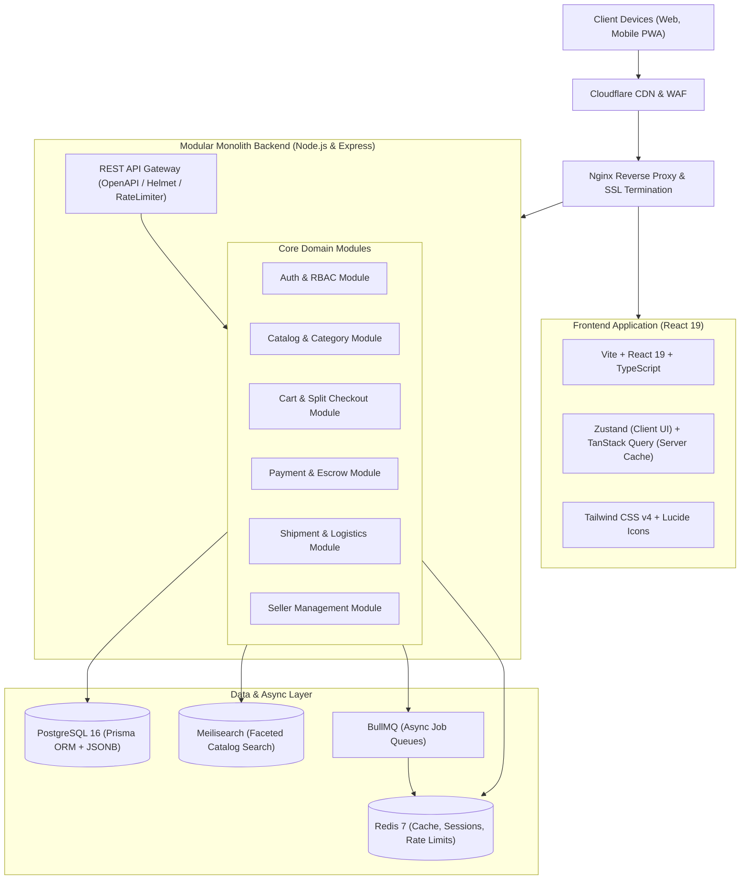

# 🛍️ ApexBazaar — Enterprise Multi-Vendor E-Commerce Marketplace

[](docs/02-architecture/architecture.md)
[](docs/02-architecture/database.md)
[-red.svg)](docs/02-architecture/architecture.md)
[](docs/02-architecture/design.md)
[](docs/02-architecture/architecture.md)
[](docs/)

**ApexBazaar** is an enterprise-grade, high-scale multi-vendor e-commerce marketplace platform architected to support **100,000+ SKUs across all product categories** and **10,000+ concurrent active shoppers**. Engineered under a strict **Documentation-First** methodology, the platform delivers a high-performance **Hybrid Supabase (PostgreSQL) + Firebase** cloud architecture: Supabase manages structured relational transactions, dynamic JSONB variant schemas, multi-seller split orders, and financial escrow ledgers, while Firebase provides carrier-grade Phone SMS OTP authentication, Cloud Storage for media assets and KYC proofs, and real-time Firestore collections for AI shopping chat and delivery driver telemetry.

---

## 📁 Repository Structure

```text
hayroo/
├── frontend/                # React 19 + Vite + Tailwind CSS Frontend
│   ├── public/              # Static assets, favicons, site.webmanifest
│   ├── src/                 # Application source code
│   │   ├── api/             # Axios client & request interceptors
│   │   ├── assets/          # Component media & images
│   │   ├── components/      # UI components (storefront, seller, admin, delivery)
│   │   ├── hooks/           # Custom React hooks
│   │   ├── pages/           # Route views & sub-portals
│   │   ├── store/           # Zustand client state stores
│   │   └── utils/           # Helper utilities
│   ├── index.html           # Main HTML entrypoint
│   ├── vite.config.js       # Vite bundler configuration
│   ├── eslint.config.js     # Frontend ESLint configuration
│   ├── .env.example         # Frontend environment templates
│   └── package.json         # Frontend dependencies & scripts
│
├── backend/                 # Node.js + Express REST API & Database
│   ├── config/              # Database (MongoDB/Supabase), Firebase & Swagger setup
│   ├── controllers/         # Endpoint request controllers
│   ├── middleware/          # Auth, RBAC, error & upload middlewares
│   ├── models/              # Mongoose data models
│   ├── prisma/              # Prisma schema & database migrations
│   ├── routes/              # Express API route declarations
│   ├── services/            # Business logic & payment services
│   ├── utils/               # JWT token & formatting utilities
│   ├── uploads/             # Static file uploads directory
│   ├── __tests__/           # Jest & Supertest integration tests
│   ├── app.js               # Express application initialization
│   ├── index.js             # Server entrypoint (port 5000)
│   ├── seed.js              # Initial database seed script
│   ├── .env.example         # Backend environment templates
│   └── package.json         # Backend dependencies & scripts
│
├── docs/                    # Complete architectural, API & design documentation
├── scripts/                 # Utility automation scripts
├── package.json             # Root workspace orchestration
└── .env.example             # Global environment configuration
```

---

## 📑 Complete Documentation Index

All architectural, security, design, and operational specifications are written and ratified before implementation. The documentation represents the single source of truth for the codebase.

| Section | Document | Summary Description |
| :--- | :--- | :--- |
| **01. Planning** | [**PRD (Product Requirements Document)**](docs/01-planning/prd.md) | Business goals, 5 ecosystem personas, user stories, functional & non-functional specifications, success metrics, and scope boundaries. |
| | [**Roadmap & Implementation Plan**](docs/01-planning/plan.md) | Phased delivery schedule (MVP, v1, v2), sprint milestones, engineering effort estimates, risk mitigation matrix, and release gates. |
| **02. Architecture** | [**System Architecture**](docs/02-architecture/architecture.md) | End-to-end Mermaid system topologies, modular monolith domain boundaries, event-driven async queues, caching, and horizontal scaling strategy. |
| | [**Design System & UI/UX**](docs/02-architecture/design.md) | Design tokens, responsive component specs, layouts for consumer storefront, seller vendor portal, admin moderation hub, and driver PWA. |
| | [**Database & Data Model**](docs/02-architecture/database.md) | Comprehensive PostgreSQL + Prisma ERD, JSONB attribute schemas, high-throughput indexes, migration workflows, and seed datasets. |
| **03. Security & APIs** | [**Authentication & Security**](docs/03-security-and-apis/authentication.md) | Phone OTP + JWT rotation, RBAC security matrix across 5 roles, seller KYC verification workflows, OWASP Top 10 defense, and Redis rate limiting. |
| | [**REST API Specification**](docs/03-security-and-apis/api.md) | Complete OpenAPI/REST endpoint contract grouped by persona, request/response JSON payloads, pagination standards, and error codes. |
| | [**Model Context Protocol (MCP)**](docs/03-security-and-apis/mcp.md) | External agent MCP tools, schema definitions for product discovery, order tracking, seller inventory telemetry, and auth boundaries. |
| **04. Features & Agents**| [**Feature Specifications**](docs/04-features-and-agents/feature.md) | Deep functional criteria and edge-case handling for cart, multi-seller split checkout, coupons, returns, disputes, and escrow releases. |
| | [**AI Agent Suite**](docs/04-features-and-agents/agent.md) | Architecture for conversational shopping assistant, 24/7 support bot, seller catalog listing helper, and anti-fraud fake review detector. |
| | [**Integrations & Webhooks**](docs/04-features-and-agents/integration.md) | Integration protocols for Razorpay/Stripe, Shiprocket/Delhivery 3PL logistics, SMS/WhatsApp/SES messaging, and Indian GST compliance. |
| **05. Operations** | [**Setup & Deployment Guide**](docs/05-operations/setup.md) | Environment setup, `.env.example`, Docker Compose orchestration, multi-stage CI/CD pipelines, and cloud hosting runbooks. |
| | [**Testing Strategy**](docs/05-operations/testing.md) | Unit, integration, Playwright E2E test suites, k6 load testing scripts, coverage thresholds, and regression smoke tests. |
| | [**Observability & Debugging**](docs/05-operations/debugging.md) | Structured logging (Winston), Sentry APM, Prometheus/Grafana dashboards, error diagnosis runbooks, and incident response runbooks. |

---

## 🛠️ Technology Stack



### 1. Frontend Architecture
- **Framework & Runtime**: React 19, Vite 8, Tailwind CSS v4.
- **Routing & Navigation**: React Router v7 with route segments.
- **State Management**: **Zustand** for lightweight client state (theme, cart drawer, modals, guest sessions).
- **Styling & UI**: Tailwind CSS v4, dynamic CSS variables for theme support, Lucide React iconography.
- **API Communication**: Axios with automatic request interception, guest session tagging, and token refresh.

### 2. Backend & API Services
- **Runtime & Framework**: Node.js 22 LTS, Express 5.
- **Communication Protocol**: REST APIs documented with OpenAPI / Swagger v3.
- **Validation & Transformation**: Zod validation schemas.
- **Authentication & Security**: Argon2id/bcrypt password hashing, rotating JWT Access/Refresh tokens, Helmet HTTP headers, CORS whitelisting, and rate-limiting guards.

### 3. Data, Caching & Search Engine
- **Primary Database**: MongoDB / PostgreSQL managed via Prisma ORM.
- **In-Memory Cache & Session Store**: Redis 7 cluster for session tracking, cart persistence, and high-speed API response caching.
- **Search & Discovery Engine**: Catalog search with multi-facet filtering across SKU variations.

### 4. Storage, Payments & Logistics
- **Object Storage & Media**: Local uploads and Firebase Cloud Storage.
- **Payment & Split Settlement**: **Razorpay** (UPI Intent, Cards, NetBanking, COD with OTP validation).
- **Logistics & Tracking**: Multi-carrier courier tracking with Delivery Partner Web/PWA interface.

---

## 👥 Ecosystem Roles & Permissions

ApexBazaar provides dedicated experiences and authorization boundaries for five key personas:

| Role | Key Capabilities & Interface | Primary Access Boundary |
| :--- | :--- | :--- |
| **1. Customer** | Search catalog, multi-vendor cart, split checkout, order tracking, cancellation/returns, reviews & questions. | Consumer Storefront (`/`) |
| **2. Seller / Vendor** | Business KYC onboarding, inventory management, dynamic variant pricing, order fulfillment, shipping labels, payout ledger. | Seller Portal (`/seller`) |
| **3. Super Admin** | Platform-wide analytics, category hierarchy management, seller approval, dispute arbitration, commission rules, audit logs. | Admin Hub (`/admin`) |
| **4. Support Staff** | Order history inspection, customer return/refund dispute resolution, ticket routing, customer outreach. | Support Desk (`/support`) |
| **5. Delivery Partner** | PWA run-sheet, package pickup confirmation, doorstep OTP verification, delivery failure reporting, payout logs. | Delivery PWA (`/delivery`) |

---

## 🚀 Quick Start (Local Development)

### Prerequisites
- **Node.js**: `v20.x` or `v22.x` LTS
- **Package Manager**: `npm` or `pnpm`

### 1. Setup Environment
```bash
# Copy sample environment configuration
cp .env.example .env
cp frontend/.env.example frontend/.env
cp backend/.env.example backend/.env
```

### 2. Install Dependencies & Seed Database
```bash
# Install dependencies across workspaces (root, frontend, and backend)
npm install

# Seed initial categories, admin user, and sample multi-vendor products
npm run seed
# (or cd backend && npm run seed)
```

### 3. Run Development Servers
```bash
# Run backend API server (Express on port 5000)
npm run dev:backend
# (or cd backend && npm run dev)

# Run frontend application (Vite on port 5173) in a separate terminal
npm run dev:frontend
# (or cd frontend && npm run dev)
```

Access the interfaces:
- **Storefront**: `http://localhost:5173`
- **Seller Portal**: `http://localhost:5173/seller`
- **Admin Hub**: `http://localhost:5173/admin`
- **Delivery Partner PWA**: `http://localhost:5173/delivery`
- **Swagger API Docs**: `http://localhost:5000/api-docs`

---

## 🔒 Security & Compliance Principles
1. **Zero Trust & Least Privilege**: Role-based access control (RBAC) enforced at both the API gateway and individual controller routes.
2. **Indian Tax & Regulatory Compliance**: Fully compliant with Indian GST rules (HSN/SAC codes, CGST/SGST/IGST breakdown), Digital Personal Data Protection (DPDP) Act 2023, and Consumer Protection (E-Commerce) Rules 2020.
3. **Financial Escrow Protection**: Seller payouts are secured in an escrow holding balance and automatically disbursed only after customer return/replacement windows close.

---

## 📜 License
Distributed under the MIT License. See `LICENSE` for more details.
