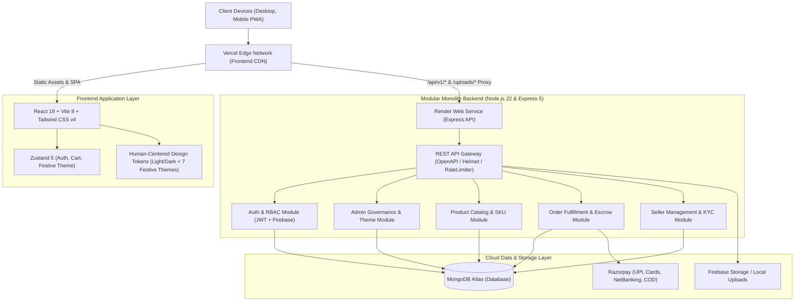

# 🛍️ Hayroo — Enterprise Multi-Vendor E-Commerce Marketplace

[](https://hayroo-mocha.vercel.app)
[](https://hayroo-d6uv.onrender.com)
[](https://hayroo-d6uv.onrender.com/health)
[](https://hayroo-d6uv.onrender.com/api-docs)
[](https://hayroo-mocha.vercel.app)
[](https://hayroo-d6uv.onrender.com)
[](LICENSE)

**Hayroo** is an enterprise-grade, high-scale multi-vendor e-commerce marketplace platform engineered for **100,000+ SKUs across diverse consumer categories** and **10,000+ concurrent active shoppers**. 

The platform features an **Amazon & Flipkart-grade Admin Governance Console**, a dedicated **Vendor & Seller Central**, a **Carrier-grade Delivery Partner PWA**, and an **Admin-Controlled Minimalist Festive Theme Engine** that propagates seasonal color palettes and promotional announcement ribbons site-wide in real-time.

---

## 🌐 Live Production Deployments

| Component | Platform | Live URL / Endpoint | Status |
| :--- | :--- | :--- | :--- |
| **Storefront & Portals** | Vercel Edge | **[https://hayroo-mocha.vercel.app](https://hayroo-mocha.vercel.app)** | `Production Active` |
| **Admin Central** | Vercel Edge | **[https://hayroo-mocha.vercel.app/admin](https://hayroo-mocha.vercel.app/admin)** | `Protected (Role: ADMIN)` |
| **Seller Central** | Vercel Edge | **[https://hayroo-mocha.vercel.app/seller](https://hayroo-mocha.vercel.app/seller)** | `Protected (Role: SELLER)` |
| **Delivery Hub** | Vercel Edge | **[https://hayroo-mocha.vercel.app/delivery](https://hayroo-mocha.vercel.app/delivery)** | `Protected (Role: DELIVERY_PARTNER)` |
| **Backend REST API** | Render Web Service | **[https://hayroo-d6uv.onrender.com](https://hayroo-d6uv.onrender.com)** | `Production Active` |
| **API Health Check** | Render Web Service | **[https://hayroo-d6uv.onrender.com/health](https://hayroo-d6uv.onrender.com/health)** | `200 OK (MongoDB Connected)` |
| **Interactive Swagger API** | Render Web Service | **[https://hayroo-d6uv.onrender.com/api-docs](https://hayroo-d6uv.onrender.com/api-docs)** | `OpenAPI 3.0 Interactive` |

> [!NOTE]
> **Edge Proxy Integration**: Vercel seamlessly reverse-proxies `/api/v1/:path*` and `/uploads/:path*` directly to the Render cloud backend, eliminating cross-origin latency while keeping strict CORS security intact.

---

## 🧪 Reviewer & Evaluator Demo Credentials

To evaluate the full multi-persona platform experience (Customer, Seller, and Super Admin) without needing phone OTPs, use the following pre-verified demo credentials on the live site:

| Persona / Role | Demo Email | Demo Password | Direct Portal | Key Features to Test |
| :--- | :--- | :--- | :--- | :--- |
| **🛡️ Super Administrator** | `admin@apexbazaar.com` | `admin123` | **[/admin](https://hayroo-mocha.vercel.app/admin)** | Executive GMV KPIs, 7 Festive Themes Engine, Master Catalog, Order fulfillment updates, Seller KYC queue, Promo coupons, Dispute arbitration. |
| **🏪 Verified Merchant / Seller** | `seller.tech@apexbazaar.com` | `seller123` | **[/seller](https://hayroo-mocha.vercel.app/seller)** | Store inventory, Add/Edit SKU with live image file upload (`/api/v1/upload`), low-stock alerts, financial escrow ledger. |
| **🛒 Shopper / Customer** | `rohan@gmail.com` | `password123` | **[/](https://hayroo-mocha.vercel.app)** | Category browsing, multi-attribute filter, cart drawer, split checkout, wishlist, order history at `/account`. |

> [!TIP]
> **1-Click Fast Access in UI**: When visiting [https://hayroo-mocha.vercel.app](https://hayroo-mocha.vercel.app), click **"Sign In"** in the top navigation bar. The modal includes **1-Click Demo Buttons** (`Demo Admin` & `Demo Seller`) that automatically log you in and open the corresponding governance console instantly!

---

## 🌟 Key Platform Modules & Latest Features

### 1. 🛡️ Flipkart & Amazon-Grade Admin Governance Central (`/admin`)
An executive command center equipped with 8 core administration modules:
* **Executive Storefront KPI Strip**: Real-time Gross Merchandise Value (GMV ₹), Platform Commission (10%), Storewide Order Volume, Active Verified Merchants, Registered Users, and Low-Stock (<10 units) alerts.
* **Master Product Catalog Control**: Cross-vendor search across all marketplace products with Category & Stock Level filters (`In Stock`, `Low Stock`, `Out of Stock`).
  * 1-Click **Homepage Feature** toggle (`isFeatured`).
  * 1-Click **Lightning Flash Deals** toggle (`isFlashSale`).
  * Unified Add/Edit SKU Modal with **Direct Multipart Image Upload** (`/api/v1/upload`) or URL input with live preview.
  * Delete SKU with safe confirmation dialog.
* **Master Order Fulfillment & Dispatch**: Filter orders by status (`Placed`, `Confirmed`, `Dispatched`, `Delivered`, `Cancelled`). Inline status updater updates the order and customer tracking history in real-time.
* **Full Order Invoice Inspection**: Customer shipping address, contact, payment method (COD/Online), payment status, and ordered item breakdown with unit prices.
* **Seller KYC Governance & Onboarding**:
  * **Pending KYC Queue**: Verification of merchant GSTIN, PAN card, Bank Account Number, IFSC code, and registered address. 1-click **Approve & Activate Store** or **Reject KYC** with documented reason.
  * **Merchants Directory**: Complete list of onboarded sellers with store slugs (`/store/:slug`), platform commission %, seller ratings (⭐ 4.8), and a 1-click **Suspend / Activate Merchant** switch.
* **Customer & Role Management**: Search accounts by name, email, or phone. Instant in-place role modification (`CUSTOMER`, `SELLER`, `DELIVERY_PARTNER`, `SUPPORT_STAFF`, `ADMIN`) and account suspension/activation toggle.
* **Promotional Campaigns & Coupons**: Create discount codes with custom discount %, minimum order amount (₹), and expiration timer. 1-click copy code, active/expired status indicator, and delete campaign.
* **Disputes & Returns Arbitration**: Amazon A-to-Z style guarantee arbitration. Inspect return claims, claimant customer details, refund amounts, and execute 1-click **Approve Refund** or **Reject Claim**.

---

### 2. 🎨 Minimalist & Aesthetic Festive Themes Engine
A site-wide theme engine designed for Indian and international festivals with minimalist, human-centered luxury design tokens:
* **7 Curated Aesthetic Palettes (Light & Dark Modes)**:
  1. **🌿 Botanical Emerald (हयरू क्लासिक - Default)**: Warm alabaster stone (`#FAF9F6`), botanical emerald (`#0F6B52`), obsidian slate in dark mode (`#0D0F0E`).
  2. **🪔 Diwali Festive Gold & Amber (दीपावली उत्सव)**: Luminous royal saffron amber (`#B25E00`), champagne alabaster, glowing gold (`#E58A1F`) over charcoal amber obsidian in dark mode.
  3. **🎨 Holi Spring Blossom & Coral (होली उत्सव)**: Coral rosewood (`#C93B62`), warm terracotta sunset, whisper blush pearl, neon rose petal (`#E65A82`) in dark mode.
  4. **🌙 Eid Celestial Jade & Teal (ईद व रमजान मुबारक)**: Royal celestial teal (`#0D6E6E`), moonlight desert sand alabaster, luminous crescent teal (`#21A3A3`) in dark mode.
  5. **🎄 Christmas Velvet Crimson & Winter Frost (क्रिसमस)**: Velvet ruby crimson (`#A82020`), alpine frost, dark garnet obsidian with glowing ruby (`#E03E3E`) in dark mode.
  6. **🇮🇳 Independence & Republic Pride (राष्ट्रीय पर्व)**: National saffron orange (`#C24E00`), subtle chakra indigo accents, pure pearl canvas, and flame saffron in dark mode.
  7. **🌧️ Monsoon Oceanic Indigo (मानसून व मिडनाइट)**: Deep oceanic indigo (`#2C4875`), serene slate rain, twilight cool slate (`#4B78B8`) in dark mode.
* **Admin-Exclusive Security**: Theme switching is strictly guarded by `authenticate` + `authorize('ADMIN')` (`PATCH /api/v1/admin/theme`). Non-admins receive `403 Forbidden`.
* **Zero-Flicker Real-Time Propagation**: Changes save to MongoDB and propagate instantly via public `GET /api/v1/theme` to all connected browsers.
* **Celebratory Announcement Ribbon (`FestivalBanner.jsx`)**: Non-intrusive top banner with 1-click festive greeting presets, custom banner text input, and customer dismiss capability.

---

### 3. 🏪 Vendor & Seller Central (`/seller`)
* Real-time vendor inventory management and low-stock replenish alerts.
* Unified Add & Edit SKU modal with direct multipart file uploads.
* Financial escrow ledger: track available balance vs unsettled escrow funds.
* Multi-order dispatch and package fulfillment tracking.

---

### 4. 🚚 Delivery Partner Hub (`/delivery`)
* Progressive Web App (PWA) layout designed for couriers and field logistics agents.
* Run-sheet of assigned deliveries with customer address directions.
* Doorstep OTP verification and real-time delivery status updates.

---

### 5. 🔐 Enterprise Authentication & Security
* **Firebase Google Sign-In**: Clean private key parser supporting multiline RSA PEM formatting, null phone collision fix, and automatic user profile synthesis.
* **Phone SMS OTP Verification**: Phone verification via Firebase Auth.
* **JWT Token Rotation**: Secure HTTP-only access and refresh tokens.
* **Zero Trust RBAC**: Enforced across 5 roles (`CUSTOMER`, `SELLER`, `DELIVERY_PARTNER`, `SUPPORT_STAFF`, `ADMIN`).
* **Input Sanitization & Rate Limiting**: MongoDB query injection sanitization, Helmet headers, CORS origin whitelisting, and rate-limiting guards.

---

## 📁 Repository Structure

```text
hayroo/
├── frontend/                # React 19 + Vite 8 + Tailwind CSS v4 Frontend
│   ├── public/              # Static assets, icons, site.webmanifest
│   ├── src/                 # Application source code
│   │   ├── api/             # Axios client with request interceptors & CSRF protection
│   │   ├── assets/          # Brand media & vector assets
│   │   ├── components/      # UI components (Navbar, Footer, FestivalBanner, Drawers, Modals)
│   │   ├── hooks/           # Custom React hooks (useSeo, useUtmTracker)
│   │   ├── pages/           # Storefront, SellerPage, AdminPage, DeliveryPage, Cart, Checkout
│   │   ├── store/           # Zustand state stores (useAuthStore, useCartStore, useThemeStore)
│   │   ├── utils/           # Analytics, formatters, and helpers
│   │   ├── App.jsx          # Root layout and lazy route configuration
│   │   ├── index.css        # Hayroo design tokens & 7 festive themes (Light/Dark)
│   │   └── main.jsx         # React application entrypoint
│   ├── vite.config.js       # Vite build optimization configuration
│   ├── eslint.config.js     # ESLint configuration
│   └── package.json         # Frontend dependencies & build scripts
│
├── backend/                 # Node.js 22 + Express 5 REST API
│   ├── config/              # MongoDB connection, Firebase Admin SDK & Swagger OpenAPI
│   ├── controllers/         # Request handlers (admin, auth, cart, order, product, theme, etc.)
│   ├── middleware/          # JWT authentication, RBAC authorization, file upload, error handlers
│   ├── models/              # Mongoose schemas (User, Product, Order, SellerKYC, SiteSettings, etc.)
│   ├── routes/              # Express API route modules
│   ├── services/            # Payment gateways (Razorpay), escrow settlements & notifications
│   ├── utils/               # Async handlers, API response helpers, JWT signers
│   ├── uploads/             # Static product media uploads directory
│   ├── __tests__/           # Jest & Supertest API integration tests
│   ├── app.js               # Express app configuration & middleware pipeline
│   ├── index.js             # HTTP server entrypoint (port 5000)
│   ├── seed.js              # Comprehensive catalog & admin user database seed script
│   └── package.json         # Backend dependencies & server scripts
│
├── docs/                    # Architectural specs, API contracts, PRD & operational runbooks
├── scripts/                 # Monorepo management scripts
├── vercel.json              # Vercel deployment & reverse proxy configuration
├── render.yaml              # Render web service deployment configuration
└── package.json             # Root workspace orchestration
```

---

## 🛠️ Technology Stack



---

## 👥 Ecosystem Roles & Security Matrix

| Role | Key Capabilities & Interface | Primary Route | Access Level |
| :--- | :--- | :--- | :--- |
| **Customer** | Catalog search, multi-vendor cart, checkout, order tracking, returns, reviews. | `/` | Public / Customer |
| **Seller / Vendor** | Business KYC submission, SKU pricing/stock, fulfillment, escrow ledger. | `/seller` | Role: `SELLER` |
| **Delivery Partner** | Delivery run-sheet, package pickup, OTP doorstep verification. | `/delivery` | Role: `DELIVERY_PARTNER` |
| **Administrator** | Executive analytics, master catalog, order status, KYC approvals, festive themes. | `/admin` | Role: `ADMIN` |
| **Support Staff** | Customer inquiries, dispute arbitration, return inspects. | `/contact`, `/faq` | Role: `SUPPORT_STAFF` |

---

## 🚀 Quick Start (Local Development)

### Prerequisites
- **Node.js**: `v20.x` or `v22.x` LTS
- **MongoDB**: Local MongoDB instance or free MongoDB Atlas URI
- **Package Manager**: `npm`

### 1. Clone & Setup Environment
```bash
git clone https://github.com/Tanmay5555/Hayroo.git
cd Hayroo

# Copy environment templates
cp .env.example .env
cp frontend/.env.example frontend/.env
cp backend/.env.example backend/.env
```

### 2. Install Dependencies
```bash
# Installs dependencies for root, frontend, and backend workspaces
npm install
```

### 3. Seed Database (Optional but Recommended)
Populates the database with initial categories, verified sample products, coupons, and an admin user:
```bash
npm run seed
```

### 4. Run Development Servers
```bash
# Starts both frontend (port 5173) and backend (port 5000) concurrently
npm run dev

# Or start services individually:
npm run dev:frontend    # Starts Vite frontend at http://localhost:5173
npm run dev:backend     # Starts Express backend at http://localhost:5000
```

### 5. Access Interfaces
* **Storefront**: `http://localhost:5173`
* **Admin Governance Hub**: `http://localhost:5173/admin`
* **Seller Portal**: `http://localhost:5173/seller`
* **Delivery PWA**: `http://localhost:5173/delivery`
* **Interactive API Docs (Swagger)**: `http://localhost:5000/api-docs`

---

## 🧪 Testing & Code Quality

```bash
# Run backend integration & unit tests
npm test

# Run frontend ESLint checks
npm run lint

# Build production bundle
npm run build
```

---

## 📜 License
Distributed under the **MIT License**. See [LICENSE](LICENSE) for details.
