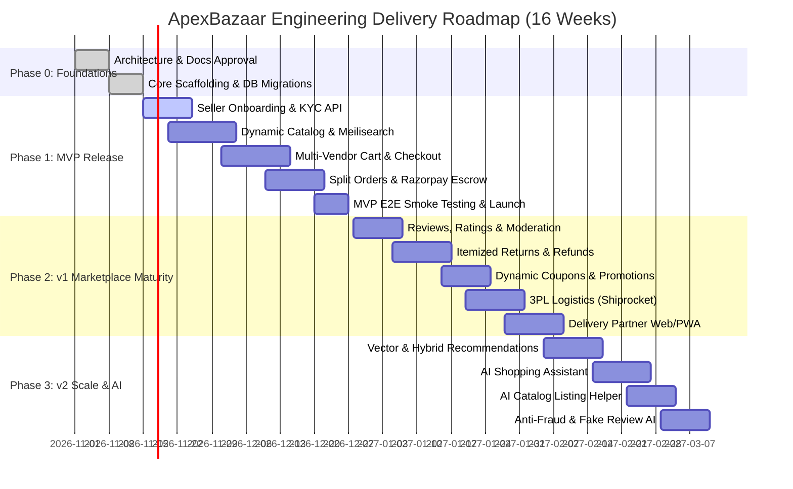
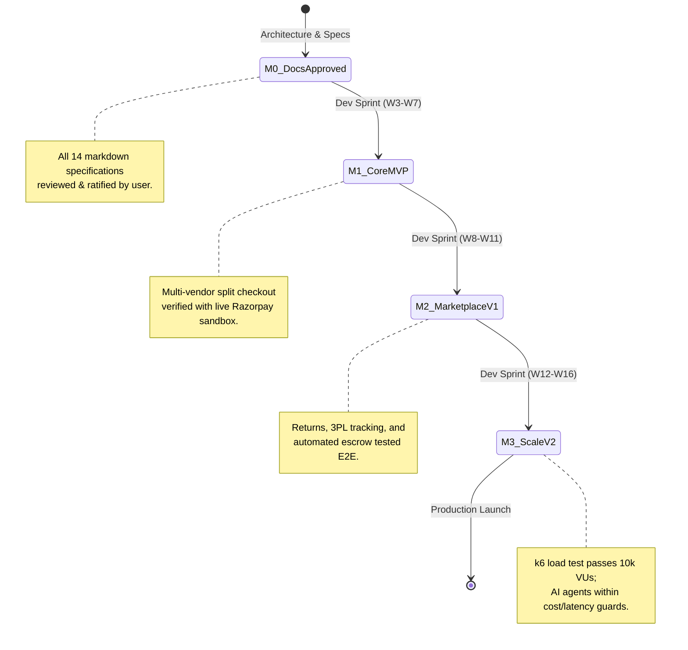

# 🗺️ Product Roadmap & Engineering Implementation Plan — ApexBazaar

**Document Version:** 1.0.0  
**Status:** Under Review / Ratified  
**Author:** Technical Architecture & Engineering Operations  
**Planning Horizon:** 16-Week Iterative Phased Execution  

---

## 1. Executive Phased Roadmap

ApexBazaar's development lifecycle is divided into three distinct release horizons following our **Documentation-First** paradigm. Every phase builds upon hardened architectural contracts, verifiable database schemas, and rigorous test coverage.

---

## 2. Release Horizon Breakdown

### 2.1 Phase 0: System Architecture & Data Foundations (Weeks 1–2)
- **Primary Goal:** Author and approve all 14 architectural, API, security, and operational specifications; scaffold the modular monolith backend and React frontend; provision Dockerized local environments.
- **Key Deliverables:**
  - Complete documentation ratification (`docs/01-planning` through `docs/05-operations`).
  - Monorepo repository layout with TypeScript, ESLint, Prettier, and Husky Git hooks.
  - PostgreSQL 16 + Prisma schema generation with initial migration and seed data.
  - Redis 7 instance with BullMQ queue scaffolding.
  - Meilisearch instance configured with custom stop-words, typo tolerance, and rank rules.
- **Exit Gate:** All documentation signed off; clean Docker Compose setup launches all storage engines, seed data loads without error, and baseline health-check endpoint returns `200 OK`.

---

### 2.2 Phase 1: MVP Core Commercial Engine (Weeks 3–7)
- **Primary Goal:** Enable end-to-end buying and selling: a seller can complete KYC, list dynamic catalog items, and a buyer can discover products, add multiple sellers' items to cart, and execute an atomic split payment.
- **Key Modules & Features:**
  1. **Authentication & RBAC:** Phone OTP and email/password login, JWT rotation, role guards for Customer, Seller, Admin.
  2. **Seller Onboarding & KYC:** Document upload (GSTIN, PAN, Bank account verification), store profile setup, admin verification queue.
  3. **Universal Catalog Engine:** Hierarchical categories, dynamic JSONB specification builder, parent-variant SKU management, price and inventory tracking.
  4. **Catalog Indexing & Search:** Synchronous/asynchronous Meilisearch synchronization using Prisma hooks and BullMQ workers.
  5. **Shopping Cart Engine:** Redis-backed guest and authenticated persistent cart, item-level stock availability checking.
  6. **Checkout & Multi-Seller Split:** Single payment authorization decomposing into master order + seller sub-orders; Razorpay Route escrow account routing.
  7. **Seller Order Dashboard:** Real-time order alerting, order acceptance, and invoice/packing slip printing.
- **Exit Gate:** A customer can register, find a multi-seller product mix via Meilisearch, successfully checkout via Razorpay test mode, and both sellers see their segregated sub-orders in real-time.

---

### 2.3 Phase 2: v1 Marketplace Maturity & Logistics (Weeks 8–11)
- **Primary Goal:** Institutionalize trust, reverse logistics, promotional campaigns, and automated fulfillment workflows.
- **Key Modules & Features:**
  1. **Reviews & Ratings:** Verified-purchaser-only review submissions, image uploads, star breakdown, upvoting/downvoting helpful reviews.
  2. **Returns, Replacements & Automated Refunds:** Customer-initiated item returns, photo proof upload, seller inspection dispute window, automated Razorpay reverse payout on warehouse confirmation.
  3. **Promotions & Coupon Engine:** Flat rate, percentage discounts, seller-funded vs. platform-funded coupons, cart-level validation rules.
  4. **3PL Carrier Integration:** Automated Shiprocket/Delhivery API dispatch, AWB tracking number assignment, rate calculation, webhook-driven tracking timeline.
  5. **Delivery Partner Web/PWA:** Dedicated responsive portal for local fleet couriers: assigned manifest, customer delivery OTP verification, failure state recording.
  6. **Automated Escrow Settlement:** BullMQ cron worker releasing escrow funds to seller bank account on T+7 days post-delivery.
- **Exit Gate:** Verified return workflow triggers reverse courier pickup and automated refund; automated daily cron settles eligible completed sub-orders without manual admin intervention.

---

### 2.4 Phase 3: v2 Scale, Intelligence & AI Agents (Weeks 12–16)
- **Primary Goal:** Scale platform conversion, automate seller cataloging, protect platform integrity with AI, and optimize search discovery.
- **Key Modules & Features:**
  1. **AI Shopping Assistant:** Conversational agent embedded in the consumer frontend providing contextual gift finding, spec comparisons, and personalized recommendations.
  2. **Seller Catalog Copilot:** AI tool that parses raw product photos or supplier invoices and automatically generates SEO-optimized titles, bullet points, and dynamic JSONB specs.
  3. **Anti-Fraud & Fake Review Detector:** LLM-powered sentiment and anomaly detection identifying incentivized, bot-generated, or cross-seller defamatory reviews.
  4. **Sponsored Product Placements & Ads:** Paid keyword bidding system for sellers to boost product visibility with CPC/CPM budget tracking.
  5. **Advanced Vector Search:** Hybrid lexical (Meilisearch) + semantic vector embeddings for natural language queries (e.g., "what should I wear to a winter beach wedding?").
- **Exit Gate:** AI agents operate under strict latency (<1.5s) and token budget limits with deterministic tool-calling guardrails; zero hallucinations on inventory or pricing.

---

## 3. Work Breakdown Structure (WBS) & Effort Estimates

Estimates are calculated using standard 2-week sprint allocations with an agile squad of:
- **1 Lead Technical Architect / Full-Stack Engineer**
- **1 Senior Backend Engineer (NestJS / DB)**
- **1 Senior Frontend Engineer (React / UI)**
- **1 QA Automation & DevOps Engineer**

| Work Package ID | Work Package Title | Key Deliverables | Backend (Days) | Frontend (Days) | DevOps / QA (Days) |
| :--- | :--- | :--- | :---: | :---: | :---: |
| **WP-00** | Environment & Documentation | All 14 doc files, Docker Compose, CI/CD pipelines, DB migrations | 4 | 3 | 5 |
| **WP-01** | Auth, Security & RBAC | JWT rotation, OTP service, password hashing, role guards, Redis rate limiting | 5 | 4 | 3 |
| **WP-02** | Seller Onboarding & KYC | GSTIN/PAN validation, document uploads, admin approval portal | 6 | 5 | 2 |
| **WP-03** | Catalog & Dynamic Schema | Nested categories, JSONB specs, variant SKU matrix, media uploads | 8 | 6 | 3 |
| **WP-04** | Search & Discovery Engine | Meilisearch indexing, BullMQ sync, faceted search UI, autocomplete | 5 | 5 | 3 |
| **WP-05** | Cart & Multi-Seller Split | Redis cart, stock locking, atomic order split creation, tax breakdown | 7 | 6 | 4 |
| **WP-06** | Razorpay Split Payments | Razorpay Route escrow, webhook listeners, idempotency keys, COD OTP | 8 | 5 | 4 |
| **WP-07** | Fulfillment & Shipping 3PL | Shiprocket API, AWB generation, shipping labels, webhook tracking | 6 | 4 | 3 |
| **WP-08** | Delivery Partner PWA | Mobile-responsive run-sheet, OTP delivery sign-off, offline sync | 4 | 6 | 3 |
| **WP-09** | Reviews, Ratings & UGC | Verified buyer guard, rating aggregates, image attachments, reporting | 4 | 4 | 2 |
| **WP-10** | Returns & Refunds Engine | Return request wizard, dispute window, reverse AWB, Razorpay refunds | 6 | 5 | 3 |
| **WP-11** | Coupons & Promotions | Coupon validation rules, usage limits, seller-funded discounts | 5 | 4 | 2 |
| **WP-12** | Settlement & Escrow Cron | BullMQ payout queue, T+7 release scheduler, seller ledger balance | 6 | 3 | 3 |
| **WP-13** | AI Agent Suite | Shopping bot, catalog helper, fake review detector, MCP server | 8 | 6 | 4 |
| **WP-14** | Performance & Hardening | k6 load testing (10k VU), Playwright E2E suites, Lighthouse > 90 | 4 | 4 | 8 |
| **Totals** | **16-Week Implementation** | **Production-Ready Multi-Vendor Platform** | **86 Days** | **70 Days** | **52 Days** |

---

## 4. Milestone Gates & Definition of Done (DoD)

### Universal Definition of Done (DoD)
A feature or pull request is considered "Done" and ready for staging deployment only when:
1. **Design & Spec Compliance:** Matches the approved documentation specifications in `docs/` without deviation.
2. **Type Safety:** 100% TypeScript compilation with zero `any` declarations in production code paths.
3. **Automated Test Coverage:** Minimum 80% line coverage for backend domain services and 75% for React components.
4. **Security & Validation:** All user inputs validated with class-validator/Zod; role-based guard applied; SQL parameterized via Prisma.
5. **Observability:** Structured logs emitted with correlation IDs; custom Sentry error tags attached.
6. **Performance Verification:** API response time verified under 200ms; frontend bundle impact analyzed.

---

## 5. Comprehensive Risk Assessment & Mitigation Matrix

| Risk ID | Category | Description | Severity | Likelihood | Mitigation Strategy |
| :--- | :--- | :--- | :---: | :---: | :--- |
| **RSK-01** | Technical | **Inventory Race Conditions during Flash Sales** Simultaneous checkout of last SKU units causing negative stock. | Critical | High | Implement Redis distributed locking (`redlock`) during checkout initialization; fallback to atomic SQL `UPDATE ... WHERE stock >= qty` with row-level locks. |
| **RSK-02** | Technical | **Meilisearch Out of Sync with Database** Database updates succeed but search engine index fails, causing ghost listings. | High | Medium | Implement transactional BullMQ outbox pattern: database changes write to an outbox table/queue; workers sync to Meilisearch with automatic retry and dead-letter queue. |
| **RSK-03** | Financial | **Seller Disappearance after Payout / Chargeback Fraud** Seller receives funds and fails to fulfill orders or customers initiate bank chargebacks. | Critical | Low | Enforce strict T+7 escrow hold post-confirmed delivery; maintain a rolling 5% security reserve for high-volume new sellers; mandatory KYC verification before first payout. |
| **RSK-04** | Operational | **3PL Shipping Aggregator Webhook Drops** Shiprocket/Delhivery tracking webhooks get dropped, leaving orders in stale status. | High | Medium | Implement scheduled reconciliation poller: every 2 hours, a BullMQ job polls the shipping API for all active in-transit shipments that have not received webhooks for > 6 hours. |
| **RSK-05** | Security | **OTP Brute-Force & Phone Number Enumeration** Attackers script login OTP requests to exhaust SMS credits or guess 4-digit codes. | High | Medium | Enforce strict Redis IP & phone rate limits (max 3 OTP requests per 10 mins; max 5 wrong attempts locks phone for 1 hour); use cryptographic random 6-digit OTPs with 5-minute TTL. |
| **RSK-06** | Business | **Counterfeit or Prohibited Goods Listed by Sellers** Disreputable sellers listing fake branded items harming marketplace reputation. | High | Medium | Mandatory brand authorization certificate upload for restricted categories (Luxury, Cosmetics, Electronics); automated AI image and title similarity screening prior to listing approval. |
| **RSK-07** | Performance| **Database Connection Pool Starvation under 10k Concurrency** Spike in traffic exhausts PostgreSQL connections, leading to 500 errors. | High | High | Implement PgBouncer connection pooler in front of PostgreSQL; cache 95% of catalog read traffic in Redis with 60-second stale-while-revalidate caching headers. |

