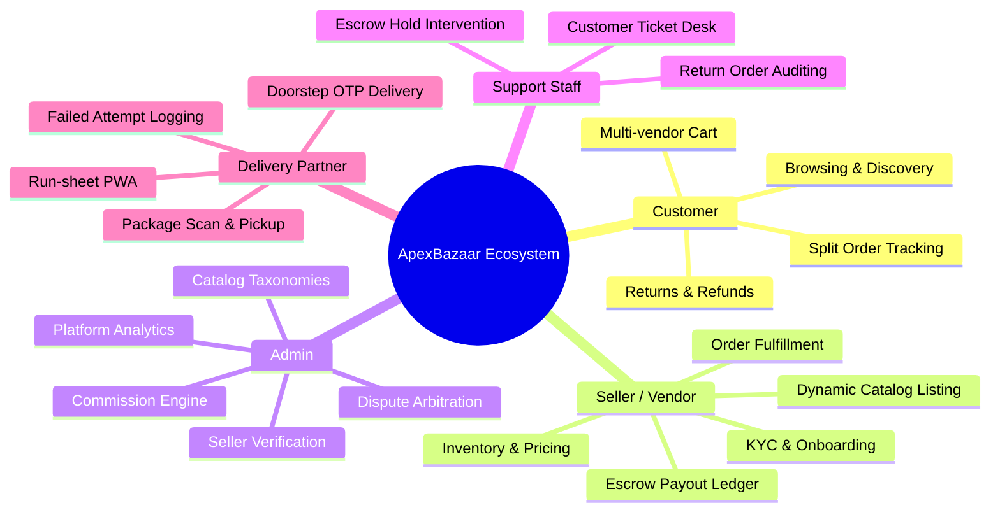
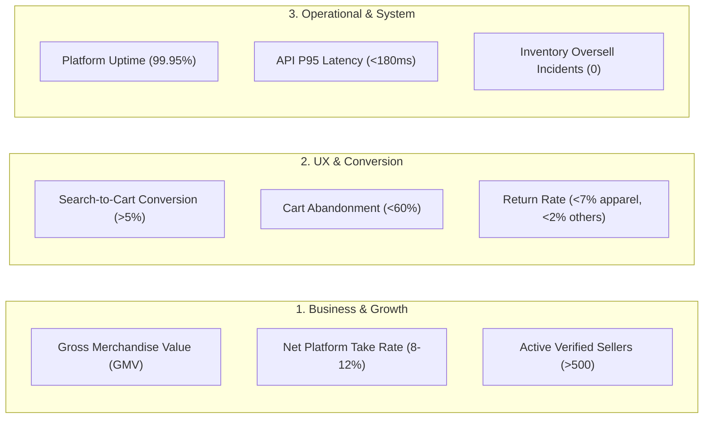

# 📋 Product Requirements Document (PRD) — ApexBazaar Marketplace

**Document Version:** 1.0.0  
**Status:** Under Review / Ratified  
**Author:** Technical Architecture & Product Strategy Team  
**System Classification:** Multi-Vendor E-Commerce Platform (B2C & B2B2C)  

---

## 1. Executive Summary & Problem Statement

### 1.1 Problem Statement
Modern multi-vendor e-commerce platforms often suffer from structural friction points:
1. **Catalog Rigidity:** Products span diverse domains (e.g., Electronics require RAM, storage, voltage; Fashion requires size, color, fabric, fit; Grocery requires expiry date, dietary flags, net weight). Relational database schemas without flexible attribute models either suffer from sparse-column sprawl or rigid EAV (Entity-Attribute-Value) performance degradation.
2. **Multi-Vendor Cart & Fulfillment Bottlenecks:** When a buyer purchases items from three different sellers in a single transaction, monolithic systems struggle with accurate split-order generation, distinct shipping calculations, independent shipment tracking, and isolated return windows.
3. **Escrow & Settlement Complexity:** Trust deficit between buyers and vendors results in disputes. Sellers require predictable payouts, while platforms must retain an escrow holding buffer during the return/replacement window to prevent negative merchant balances and fraud.
4. **Search Latency & Relevance:** Shoppers abandon platforms if search queries with minor typos or transliterated vernacular words yield zero results. Traditional SQL `LIKE` queries collapse under high concurrency and deep category filtering.
5. **Logistics Fragmentation:** Disconnect between third-party logistics (3PL) aggregators and localized/hyperlocal last-mile delivery fleets leads to tracking opacity and customer delivery failure.

### 1.2 Vision & Product Goals
**ApexBazaar** is engineered as a resilient, horizontally scalable multi-vendor marketplace designed to handle **100,000+ active SKUs** across all retail verticals and **10,000+ concurrent shoppers** with sub-30ms search response times and zero inventory overselling.

#### Core Business & Technical Objectives
- **Zero Friction Onboarding:** Self-serve seller onboarding with automated GSTIN/PAN KYC verification within under 10 minutes.
- **Universal Dynamic Catalog:** PostgreSQL JSONB attributes with GIN indexing allowing infinite category-specific specifications with zero schema migrations.
- **Atomic Split Orders & Escrow Settlement:** Single checkout cleanly partitioned into independent seller sub-orders with automated platform commission deduction and T+7 days return-cleared escrow payouts via Razorpay Route.
- **High-Velocity Discovery:** Meilisearch cluster providing typo-tolerant, instant faceted filtering across multiple categories, brands, and price tiers.
- **5-Role Ecosystem:** Specialized, role-guarded web portals for Shoppers, Vendors, Super Admins, Support Representatives, and Delivery Agents.

---

## 2. Target Market & Ecosystem Personas

### 2.1 Geographic & Regulatory Scope
- **Primary Market:** India (with global multi-currency and cross-border shipping architecture).
- **Base Currency:** Indian Rupee (`INR / ₹`), with real-time conversion display for USD (`$`) and EUR (`€`).
- **Regulatory Framework:** 
  - Indian Goods and Services Tax (GST) compliance (HSN/SAC code mapping, automated CGST/SGST intrastate vs. IGST interstate splits).
  - Consumer Protection (E-Commerce) Rules 2020 (mandatory country of origin, grievance officer disclosure, seller contact details).
  - Digital Personal Data Protection (DPDP) Act 2023 (consent management, data erasure, audit trails).

### 2.2 Ecosystem Personas & Matrix

#### Detailed Persona Descriptions

| Persona | Demographics & Context | Primary Goals | Key Pain Points |
| :--- | :--- | :--- | :--- |
| **1. Rohan Sharma (The Tech-Savvy Shopper)** | Age 28, Bangalore. Works in tech. Shops for electronics, fashion, and artisanal coffee. | Finds authentic products quickly, compares seller ratings, expects instant OTP checkout, transparent tracking. | Slow search, confusing multi-vendor delivery dates, cumbersome refund processing on returns. |
| **2. Anita Desai (The D2C Fashion Merchant)** | Age 35, Jaipur. Operates an ethnic apparel brand with 800 SKUs. | Bulk catalog upload, real-time inventory alerts, automatic shipping label generation, predictable weekly payouts. | Excessive marketplace commission cuts, delayed settlement cycles, fake return claims by fraudulent buyers. |
| **3. Rajesh Verma (Head of Platform Operations)** | Age 42, Mumbai. Oversees compliance, platform health, and catalog integrity. | Maintain 99.95% system uptime, audit seller KYC documents, configure tiered commission rates, monitor GMV. | Catalog spam, counterfeit products, manual dispute interventions, fraud spikes during flash sales. |
| **4. Kavita Nair (Tier-2 Support Specialist)** | Age 26, Pune. Customer experience specialist handling escalated disputes. | Fast access to unified order audit trails, ability to reissue refund credit or initiate seller debit holds. | Fragmented data across shipping carriers, lack of customer-seller communication logs. |
| **5. Amit Kumar (Last-Mile Delivery Partner)** | Age 24, Delhi NCR. Operates on a two-wheeler fulfilling local neighborhood deliveries. | Lightweight mobile web/PWA interface, clear delivery run-sheets, fast customer OTP verification at doorstep. | High mobile data usage, apps crashing on low-end smartphones, ambiguous delivery addresses. |

---

## 3. User Stories & Acceptance Criteria

### 3.1 Customer (Buyer) Stories
- **US-C1: Multi-Facet Search & Autocomplete**
  - *As a buyer*, I want to type partial queries with typos (e.g., "samsng hedphon") and see instant autosuggestions and faceted filters by category, price, brand, and rating.
  - *Acceptance Criteria:*
    - Search returns results within < 30ms.
    - Up to 2-character typos handled seamlessly.
    - Facet counts accurately reflect active inventory.
- **US-C2: Multi-Seller Split Cart & Checkout**
  - *As a buyer*, I want to add items from multiple distinct sellers to one cart and pay in a single payment transaction.
  - *Acceptance Criteria:*
    - Cart items grouped visually by seller with separate shipping timelines.
    - A single payment authorization via Razorpay/UPI/Cards triggers automatic creation of independent sub-orders.
    - If one seller's item is out of stock at checkout, the user is alerted with option to remove or proceed with remaining items.
- **US-C3: Itemized Self-Serve Returns**
  - *As a buyer*, I want to initiate a return or replacement for a specific item in a sub-order within its return window (e.g., 7 days from delivery).
  - *Acceptance Criteria:*
    - Must select return reason and upload damage proof photos.
    - Reverse pickup shipment is scheduled automatically via 3PL.
    - Refund is credited to original payment source upon warehouse receipt verification.

### 3.2 Seller (Vendor) Stories
- **US-S1: Self-Service KYC & Store Setup**
  - *As a seller*, I want to register using my phone/email, provide GSTIN, PAN, and Bank Account details, and verify business credentials before listing products.
  - *Acceptance Criteria:*
    - Automated regex and API verification for GSTIN and PAN.
    - Bank account validated via penny-drop or IFSC lookup.
    - Seller account remains in `PENDING_VERIFICATION` status until Admin approval.
- **US-S2: Flexible Variant & Dynamic Specification Listing**
  - *As a seller*, I want to list a product in "Electronics" with specs like RAM and Storage, or in "Apparel" with Size and Color, without engineering schema changes.
  - *Acceptance Criteria:*
    - Dynamic form rendered based on Category JSON Schema.
    - Variant matrix generated automatically (e.g., 3 sizes × 4 colors = 12 SKUs).
    - SKU-level pricing, inventory threshold, and barcode (EAN/UPC) assignment.
- **US-S3: Fulfillment & Shipping Label Generation**
  - *As a seller*, I want to receive real-time notifications of new orders, pack items, and generate compliant GST tax invoices and 3PL shipping labels with barcodes.
  - *Acceptance Criteria:*
    - Click-to-generate PDF shipping label with AWB barcode.
    - Automatic pickup request dispatched to Shiprocket/Delhivery.
    - Status transitions from `PROCESSING` to `READY_FOR_PICKUP`.
- **US-S4: Transparent Escrow & Payout Ledger**
  - *As a seller*, I want to see my gross sales, platform commission deductions, shipping charges, GST withheld (TCS), and pending escrow release dates.
  - *Acceptance Criteria:*
    - Ledger displays `UNSETTLED_ESCROW` vs. `SETTLED_FUNDS`.
    - Automated release triggered exactly 7 days after verified delivery date minus any open return disputes.

### 3.3 Super Admin Stories
- **US-A1: Category Tree & Dynamic Attribute Schema Management**
  - *As an admin*, I want to build deep category trees (up to 4 levels) and define JSON validation schemas for category-specific attributes.
  - *Acceptance Criteria:*
    - Drag-and-drop category hierarchy UI.
    - Schema builder enforcing required attributes (e.g., "Screen Size" is required for TVs).
- **US-A2: Commission Matrix Configuration**
  - *As an admin*, I want to set platform commission percentages per category (e.g., 15% on Fashion, 5% on Electronics) and override rates for premier vendors.
  - *Acceptance Criteria:*
    - Global default commission rate configurable.
    - Category-level override and Seller-level specific contract overrides.
    - Commission applied automatically during split order calculation.

### 3.4 Delivery Partner Stories
- **US-D1: Daily Assigned Run-Sheet & OTP Doorstep Delivery**
  - *As a delivery partner*, I want to see my assigned route of deliveries on my mobile browser, update delivery status, and complete handoff via customer OTP.
  - *Acceptance Criteria:*
    - Mobile-optimized responsive PWA interface with offline cache.
    - Package handoff requires entering a 4-digit OTP sent to customer's phone/email.
    - Successful OTP immediately marks package `DELIVERED` and triggers timestamped notification.

---

## 4. Functional Requirements

### 4.1 Product Catalog & Flexible Attributes
| Feature ID | Feature Name | Description | Priority |
| :--- | :--- | :--- | :--- |
| **FR-CAT-01** | Nested Category Tree | Recursive parent-child categories up to 4 levels deep (e.g., Electronics > Audio > Headphones > Wireless). | P0 (Must Have) |
| **FR-CAT-02** | JSONB Dynamic Attributes | Category-defined schema specifying attributes (data type, dropdown values, unit of measure, mandatory flag). | P0 (Must Have) |
| **FR-CAT-03** | Multi-Variant SKUs | Parent product with multiple child SKUs differing by attributes (e.g., iPhone 15 Pro - Titanium / 256GB). | P0 (Must Have) |
| **FR-CAT-04** | Media Management | Upload up to 10 images and 1 video per product with automatic WebP/AVIF compression and CDN optimization. | P1 (High) |
| **FR-CAT-05** | Inventory Locking | Pessimistic/Redis distributed locking during checkout to prevent overselling on flash sale items. | P0 (Must Have) |

### 4.2 Search, Discovery & Navigation
| Feature ID | Feature Name | Description | Priority |
| :--- | :--- | :--- | :--- |
| **FR-SRC-01** | Sub-30ms Typo-Tolerant Search | Meilisearch engine indexing products, categories, tags, and brand names with 1-2 character typo tolerance. | P0 (Must Have) |
| **FR-SRC-02** | Instant Autosuggest & History | As-you-type dropdown displaying matching keywords, top category shortcuts, and previous search history. | P0 (Must Have) |
| **FR-SRC-03** | Dynamic Faceted Filtering | Dynamic sidebar filters (Price Slider, Brand checkbox, Rating, Dynamic Specs like RAM, Size, Material). | P0 (Must Have) |
| **FR-SRC-04** | Synonyms & Stemming | Configurable synonym dictionaries (e.g., "cellphone" = "mobile" = "smartphone"). | P1 (High) |

### 4.3 Shopping Cart & Split Checkout
| Feature ID | Feature Name | Description | Priority |
| :--- | :--- | :--- | :--- |
| **FR-CRT-01** | Hybrid Cart (Guest + Auth) | Guest cart stored in localStorage synced seamlessly to Redis session upon customer login. | P0 (Must Have) |
| **FR-CRT-02** | Multi-Vendor Grouping | Cart item view partitioned by seller, displaying individual estimated dispatch dates and delivery fees. | P0 (Must Have) |
| **FR-CRT-03** | Dynamic Coupon Engine | Platform-wide and seller-specific coupon codes with minimum cart threshold, usage limits, and category restrictions. | P1 (High) |
| **FR-CRT-04** | Atomic Multi-Order Creation | On payment authorization, single cart decomposes into `1 Master Order` and `N Vendor Sub-Orders`. | P0 (Must Have) |

### 4.4 Payments, Escrow & Settlements
| Feature ID | Feature Name | Description | Priority |
| :--- | :--- | :--- | :--- |
| **FR-PAY-01** | Multi-Method Gateway | Razorpay supporting UPI Intent, UPI QR, NetBanking, Credit/Debit Cards, and Wallets. | P0 (Must Have) |
| **FR-PAY-02** | Cash On Delivery (COD) | COD option available based on buyer pin code serviceability; requires SMS OTP confirmation before order lock. | P1 (High) |
| **FR-PAY-03** | Automated Split Payouts | Integration with Razorpay Route / Stripe Connect: direct routing of seller funds minus commission into escrow. | P0 (Must Have) |
| **FR-PAY-04** | Escrow Release Pipeline | BullMQ cron job releasing escrow funds to seller bank account on T+7 days after successful delivery. | P0 (Must Have) |

### 4.5 Logistics & Fulfillment
| Feature ID | Feature Name | Description | Priority |
| :--- | :--- | :--- | :--- |
| **FR-LOG-01** | 3PL Aggregator API | Automated webhook dispatch with Shiprocket/Delhivery for courier allocation, AWB generation, and pickup scheduling. | P0 (Must Have) |
| **FR-LOG-02** | Internal Courier PWA | Web-based portal for assigned delivery partners: digital run-sheet, GPS geofencing, and customer OTP delivery sign-off. | P1 (High) |
| **FR-LOG-03** | Unified Tracking Timeline | Live event timeline for buyers: `Placed` → `Confirmed` → `Packed` → `Shipped` → `Out for Delivery` → `Delivered`. | P0 (Must Have) |

### 4.6 Returns, Refunds & Dispute Arbitration
| Feature ID | Feature Name | Description | Priority |
| :--- | :--- | :--- | :--- |
| **FR-RET-01** | Sub-Order Level Returns | Buyer can return individual items without returning the entire order within the category return window. | P0 (Must Have) |
| **FR-RET-02** | Reverse Logistics Dispatch | Automated AWB generation for return courier pickup upon seller or auto-approval. | P1 (High) |
| **FR-RET-03** | Automated Refund Webhooks | Automated webhook call to Razorpay/Stripe to initiate original payment method refund once item is received. | P0 (Must Have) |

---

## 5. Non-Functional Requirements (NFRs)

### 5.1 Performance & Latency
- **API Response Time:** P95 latency < 180ms for read endpoints; P95 < 350ms for write/checkout endpoints.
- **Search Latency:** Full-text and faceted search queries must return within < 30ms for 99% of requests.
- **Core Web Vitals:**
  - Largest Contentful Paint (LCP) ≤ 1.8 seconds.
  - Interaction to Next Paint (INP) ≤ 100 milliseconds.
  - Cumulative Layout Shift (CLS) ≤ 0.05.
- **Concurrency:** Support minimum 10,000 active concurrent user sessions with zero session leakage or deadlocks.

### 5.2 Scalability & Elasticity
- **Stateless Application Layer:** NestJS backend instances completely stateless; session tokens stored in Redis.
- **Read/Write Splitting:** PostgreSQL architecture designed for read replicas to offload search indexing and reporting queries.
- **Asynchronous Decoupling:** All email, SMS, notification, analytics, and settlement operations processed asynchronously via BullMQ workers.

### 5.3 Reliability, Availability & Fault Tolerance
- **System Availability:** 99.95% uptime SLA (maximum unplanned downtime < 4.38 hours per calendar year).
- **Graceful Degradation:** If Meilisearch is undergoing re-indexing, catalog browsing falls back seamlessly to indexed PostgreSQL queries.
- **Idempotency:** All payment webhooks, order creation calls, and inventory updates must enforce idempotency keys to eliminate double charges or double inventory decrements.

### 5.4 Security, Privacy & Compliance
- **Authentication:** Short-lived JWT Access Tokens (15-min expiry) paired with rotating Redis-stored Refresh Tokens (7-day expiry).
- **Password Security:** Argon2id hashing with strict entropy policy (min 8 characters, uppercase, lowercase, number, symbol).
- **OWASP Defense:** Rate-limiting via Redis Token Bucket, strict Content Security Policy (CSP), CORS origin lock, SQL injection prevention via Prisma parameterization, XSS sanitization.
- **Regulatory Compliance:** Full compliance with Indian DPDP Act 2023: user data encryption at rest (AES-256) and in transit (TLS 1.3), complete audit logs of sensitive operations, right to be forgotten pipeline.

---

## 6. Success Metrics & Key Performance Indicators (KPIs)

### Quantitative Target Matrix
| Metric Category | Specific KPI | Baseline Target | Scale Target (Year 1) |
| :--- | :--- | :--- | :--- |
| **Business** | Monthly GMV | ₹50 Lakhs | ₹5 Crores |
| **Business** | Active Catalog SKUs | 10,000 SKUs | 150,000 SKUs |
| **Conversion** | Search-to-Detail Clickthrough | > 25% | > 35% |
| **Conversion** | Cart-to-Payment Success Rate | > 78% | > 88% |
| **Logistics** | Order-to-Dispatch Time | < 36 Hours | < 18 Hours |
| **Financial** | Dispute Arbitration Turnaround | < 72 Hours | < 24 Hours |
| **Technical** | Search Query Response Time | < 50ms | < 25ms |

---

## 7. Out of Scope (Explicit Deferred Boundaries)

To ensure laser focus on the core marketplace architecture and timely delivery, the following features are explicitly deferred from the initial MVP/v1 releases:

1. **Self-Operated Warehousing (WMS):** The platform operates strictly on a drop-shipping and vendor-fulfillment model. We do not provide physical warehousing, cross-docking, or inventory storage facilities in v1.
2. **Proprietary Consumer Credit / Buy Now Pay Later (BNPL):** The platform will not act as a credit lender or carry credit risk on its balance sheet. Standard third-party BNPL providers (e.g., Simpl, LazyPay, ZestMoney) can be connected later via payment aggregators.
3. **Live Streaming / Video Commerce:** Synchronous interactive live shopping video streams are deferred to v3.
4. **Driver Turn-by-Turn Navigation Engine:** The Delivery Partner PWA will launch native map intents (Google Maps / Apple Maps) rather than embedding an in-app GIS navigation engine.
5. **Cross-Border Customs Clearance Automation:** Initial seller onboarding is restricted to Indian registered business entities; international shipping will be customer-facing export only.

