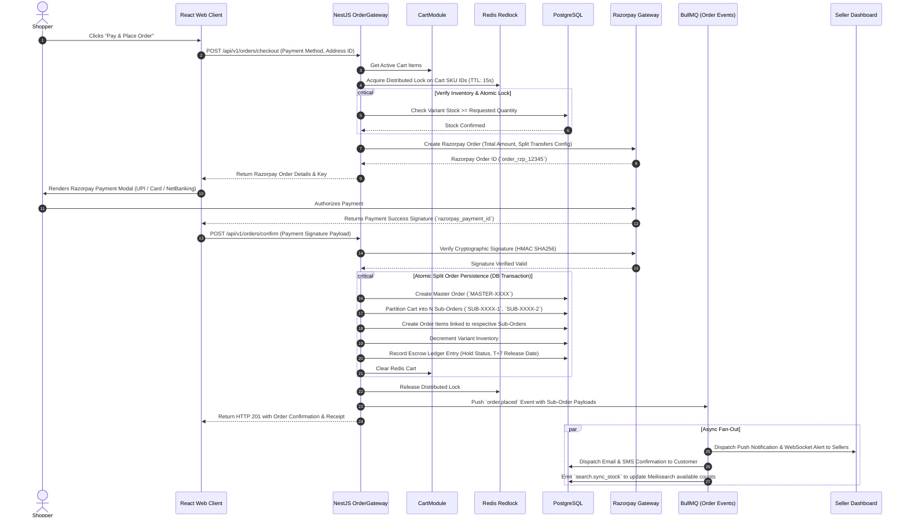
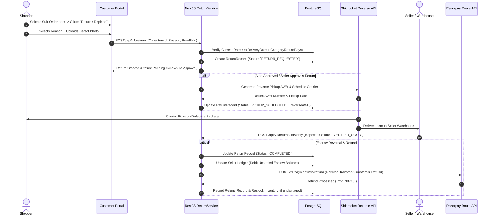
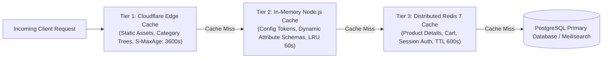
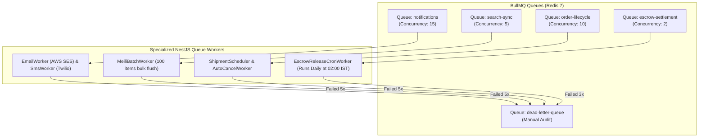

# 🏛️ System Architecture Specification — ApexBazaar

**Document Version:** 1.0.0  
**Status:** Under Review / Ratified  
**Author:** Technical Architecture & Engineering Operations  
**Architectural Paradigm:** Event-Driven Modular Monolith (Microservices-Ready)  

---

## 1. Architectural Principles & System Style

ApexBazaar is architected as an **Event-Driven Modular Monolith** implemented with **NestJS 10** on **Node.js 22 LTS**. 

### Core Architectural Axioms
1. **Strict Domain Boundaries:** Each domain (Catalog, Orders, Payments, Sellers, etc.) is isolated within a self-contained NestJS module with encapsulated entities, repositories, and private services. Modules interact through strictly typed public interfaces and asynchronous domain events.
2. **Microservices-Ready Decoupling:** Cross-module transactional coupling is forbidden. Synchronous cross-domain database joins are disallowed across bounded contexts; data dependencies are resolved via domain events or read-model projections, enabling extraction of any module into an independent microservice with zero schema refactoring.
3. **Database Read/Write Separation:** Primary transactional writes flow directly to PostgreSQL 16 through Prisma ORM with PgBouncer connection pooling. High-throughput read operations (catalog search, auto-complete, faceted browsing) are offloaded to a **Meilisearch** cluster.
4. **Asynchronous Non-Blocking Processing:** Any task not required for immediate HTTP response generation (transactional email, SMS OTP dispatch, search indexing, webhook retries, escrow release) is offloaded to Redis-backed **BullMQ** job workers.
5. **Zero-Trust Role-Based Access Control (RBAC):** Every incoming request is authenticated at the gateway level and authorized via NestJS Execution Guards enforcing fine-grained role permissions.

---

## 2. High-Level System Architecture & Infrastructure Topology

```mermaid
flowchart TD
    subgraph EdgeLayer ["Edge & CDN Layer (Global)"]
        Users["Web / Mobile Shoppers & Sellers"] --> Cloudflare["Cloudflare CDN & WAF (DDoS Shield, SSL, Edge Cache)"]
        Cloudflare --> Nginx["Nginx Reverse Proxy & Load Balancer (:80 / :443)"]
    end

    subgraph AppLayer ["Stateless Application Tier (Horizontally Scaled)"]
        Nginx --> Node1["NestJS Worker Instance 1 (:4000)"]
        Nginx --> Node2["NestJS Worker Instance 2 (:4000)"]
        Nginx --> NodeN["NestJS Worker Instance N (:4000)"]
    end

    subgraph CoreEngine ["Modular Monolith Domain Modules"]
        Node1 --- AuthMod["Auth & RBAC Module"]
        Node1 --- CatMod["Catalog & Category Module"]
        Node1 --- SearchMod["Search & Discovery Module"]
        Node1 --- CartMod["Cart & Checkout Module"]
        Node1 --- OrderMod["Order & Split Engine"]
        Node1 --- PayMod["Payment & Escrow Module"]
        Node1 --- SellerMod["Seller Management Module"]
        Node1 --- ShipMod["Shipping & Delivery Module"]
        Node1 --- NotifMod["Notification Module"]
        Node1 --- AdminMod["Admin & Governance Module"]
    end

    subgraph DataStorage ["Data & Cache Tier (Supabase + Firebase)"]
        SupabasePG[("Supabase Managed PostgreSQL 16<br>(Catalog, Split Orders, Escrow, GST, JSONB)")]
        Node1 --> SupabasePG
        Node2 --> SupabasePG

        FirebaseAuth["Firebase Authentication<br>(Phone OTP, Google OAuth, Custom Claims)"]
        Node1 --- FirebaseAuth

        FirebaseStorage["Firebase Cloud Storage<br>(Public Product Media & Secure KYC Proofs)"]
        Node1 --- FirebaseStorage

        Firestore["Firebase Firestore<br>(Realtime AI Chat History & Courier Telemetry)"]
        Node1 --- Firestore
        
        RedisCluster[("Redis 7 Cluster (Cache, Sessions, Distributed Lock)")]
        Node1 --> RedisCluster
        Node2 --> RedisCluster
        
        MeiliEngine[("Meilisearch Cluster (Faceted Search & Autocomplete)")]
        Node1 --> MeiliEngine
    end

    subgraph AsyncTier ["Async Queue & Worker Tier"]
        BullEngine["BullMQ Queue Manager"]
        RedisCluster --- BullEngine
        BullEngine --> Worker1["Background Worker: Email/SMS"]
        BullEngine --> Worker2["Background Worker: Search Sync"]
        BullEngine --> Worker3["Background Worker: Escrow Payouts"]
        BullEngine --> Worker4["Background Worker: 3PL Webhooks"]
    end

    subgraph ExternalServices ["External Services & Partners"]
        PayMod --> RazorpayAPI["Razorpay / Stripe Payment Gateway"]
        ShipMod --> ShiprocketAPI["Shiprocket / Delhivery 3PL APIs"]
        NotifMod --> TwilioSES["Twilio SMS & AWS SES Email"]
        CatMod --> S3Storage["AWS S3 / Cloudflare R2 Media Storage"]
    end
```

---

## 3. Core Domain Modules Breakdown

The backend is partitioned into 10 cohesive domain modules:

| Module Name | Bounded Context Responsibility | Key Exported Services / Events Emitted | Primary Storage & Tech |
| :--- | :--- | :--- | :--- |
| **1. AuthModule** | Phone OTP generation, password hashing (Argon2id), JWT issuance, rotating refresh tokens, RBAC guard middleware. | `AuthService`, `JwtAuthGuard`, `RolesGuard` • Event: `user.registered`, `user.login_attempt` | PostgreSQL (`User`, `RefreshToken`), Redis |
| **2. CatalogModule** | Category tree traversal, JSONB dynamic attribute validation, variant matrix calculation, media asset linking. | `CategoryService`, `ProductService`, `VariantService` • Event: `product.created`, `product.updated`, `stock.changed` | PostgreSQL (`Product`, `Category`, `Variant`), S3 |
| **3. SearchModule** | Catalog document indexing, full-text typo-tolerant search, multi-faceted filtering, instant autosuggest. | `SearchService`, `MeiliSyncService` • Consumes: `product.created`, `product.updated` | Meilisearch Engine |
| **4. CartModule** | Guest & authenticated cart persistence, inventory availability validation, coupon calculation, shipping estimation. | `CartService`, `CouponEngineService` • Event: `cart.updated`, `cart.abandoned` | Redis 7 (TTL 30 days) + PostgreSQL backup |
| **5. OrderModule** | Decomposition of Master Order into independent Seller Sub-Orders, state machine lifecycle management, cancellation. | `OrderService`, `SplitOrderEngine` • Event: `order.placed`, `suborder.cancelled` | PostgreSQL (`Order`, `SubOrder`, `OrderItem`) |
| **6. PaymentModule** | Payment authorization, Razorpay Route split escrow routing, COD OTP confirmation, refund execution. | `PaymentService`, `RazorpayRouteService` • Event: `payment.captured`, `escrow.settled` | Razorpay API, PostgreSQL (`Payment`, `Payout`) |
| **7. SellerModule** | Seller onboarding, GSTIN/PAN verification, commission override rules, balance ledger, inventory management. | `SellerService`, `KycService`, `LedgerService` • Event: `seller.approved`, `payout.disbursed` | PostgreSQL (`Seller`, `SellerKYC`, `Ledger`) |
| **8. ShippingModule** | 3PL AWB generation (Shiprocket/Delhivery), shipping label PDFs, Delivery Partner PWA run-sheet, doorstep OTP. | `ShippingService`, `DeliveryPartnerService` • Event: `shipment.created`, `shipment.delivered` | 3PL APIs, PostgreSQL (`Shipment`, `DeliveryRun`) |
| **9. NotificationModule** | Transactional email (SES), transactional SMS/WhatsApp (Twilio/Gupshup), in-app real-time web-push/SSE. | `NotificationService`, `MailWorker`, `SmsWorker` • Consumes all critical platform domain events | AWS SES, Twilio, BullMQ |
| **10. AdminModule** | Global platform metrics, category taxonomy management, dispute arbitration, commission matrix configuration. | `AdminAnalyticsService`, `DisputeService` • Event: `commission.updated`, `dispute.resolved` | PostgreSQL (`AuditLog`, `Dispute`, `Commission`) |

---

## 4. End-to-End Data Flow & Sequence Workflows

### 4.1 Multi-Seller Order Splitting & Escrow Checkout Flow
The diagram below illustrates how a single customer payment atomically breaks down into independent vendor sub-orders with escrow holds:

---

### 4.2 Reverse Logistics, Return & Escrow Refund Sequence

---

## 5. Caching & Performance Optimization Architecture

ApexBazaar employs a **3-Tier Multi-Level Caching** strategy designed to service 95%+ of read requests without hitting the primary PostgreSQL relational database:

### Caching Policies & Invalidation Rules

| Cache Tier | Storage Layer | Cached Entities & Keys | TTL | Invalidation Trigger |
| :--- | :--- | :--- | :--- | :--- |
| **Tier 1 (Edge)** | Cloudflare CDN | Category Trees, Brand Directory, Static CMS Pages, Product Images | 1 hour | Admin updates category hierarchy; purged via Cloudflare API webhook. |
| **Tier 2 (In-Memory)**| Node.js LRU Cache | Category-specific JSONB Attribute Schemas, Platform Commission Rates | 60 seconds | Periodic polling or Redis Pub/Sub broadcast on admin update. |
| **Tier 3 (Distributed)**| Redis 7 Cluster | `product:{id}:details`, `seller:{id}:profile`, `user:{id}:cart` | 10 minutes | Direct eviction on `product.updated`, `stock.changed`, or `cart.modified`. |

---

## 6. Asynchronous Queue Topology (BullMQ on Redis)

All background jobs are managed by dedicated BullMQ queues with explicit concurrency limits, exponential backoff retries, and dead-letter queue (DLQ) containment:

### Queue Configurations & Retry Guarantees
1. **Search Sync Queue (`search-sync`):**
   - Batches product updates every 500ms or 100 documents.
   - Idempotent updates; duplicate events collapse into single Meilisearch document upserts.
2. **Escrow Settlement Queue (`escrow-settlement`):**
   - Scheduled cron job running daily at `02:00 AM IST`.
   - Queries all sub-orders where `status = DELIVERED`, `delivered_at <= NOW() - INTERVAL '7 DAYS'`, and `escrow_status = HELD`.
   - Initiates transfers via Razorpay Route API and writes audit ledger entries in a strict SQL transaction.
3. **Dead-Letter Queue (DLQ):**
   - Any job failing past max attempts emits an urgent alert to Sentry and the Ops Slack channel with full payload and stack trace.

---

## 7. Scalability, High Availability & Deployment Topology

### 7.1 Horizontal Scalability Mechanics
- **Stateless App Nodes:** The NestJS API process maintains zero local state. Any server can be instantly destroyed or scaled up in response to CPU/memory metrics via AWS Auto-Scaling Groups or Kubernetes HPA.
- **Database Connection Optimization:** Direct connections from Node.js applications are routed through **PgBouncer** in transaction pooling mode. This allows 500+ application worker threads to share 50 dedicated PostgreSQL connection slots without connection exhaustion.
- **Search Engine Scaling:** Meilisearch runs on dedicated high-memory instances with read replicas to handle up to 2,500 search queries per second at sub-30ms latencies.

### 7.2 Fault Tolerance & Circuit Breaker Strategy
- **3PL & Payment Gateway Circuit Breakers:** External API integrations (Razorpay, Shiprocket, Twilio) are wrapped in `Opossum` circuit breakers. If 5 consecutive requests fail or timeout (>3000ms), the circuit trips open for 30 seconds:
  - If Shiprocket fails: Shipments are queued in database as `PENDING_CARRIER_ALLOCATION` and auto-retried when the circuit resets.
  - If Meilisearch fails: Catalog browsing degrades gracefully to an indexed PostgreSQL SQL query fallback (`SELECT * FROM products WHERE ... ORDER BY created_at DESC`).

