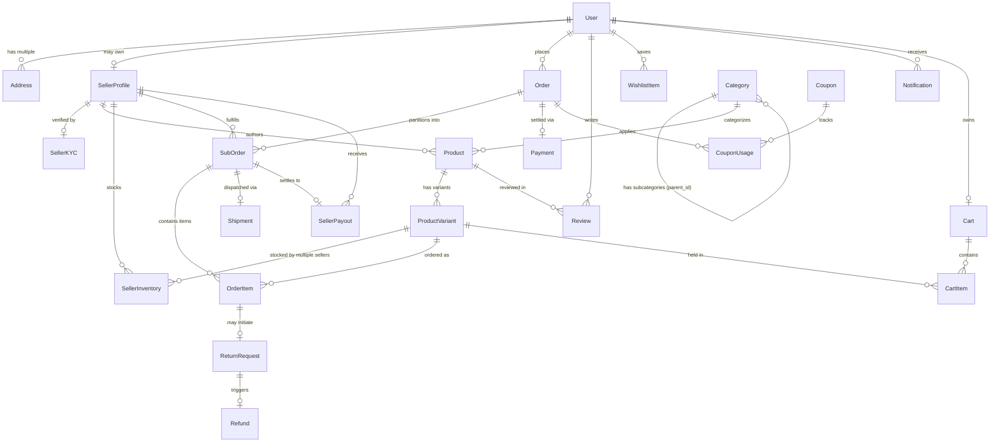

# 🗄️ Database Architecture & Relational Schema Specification — ApexBazaar

**Document Version:** 1.1.0  
**Status:** Under Review / Ratified  
**Author:** Lead Database Architect & Backend Engineering Team  
**Primary Transactional Engine:** Supabase Managed PostgreSQL 16 LTS with Prisma ORM & RLS  
**Realtime & Media Engine:** Firebase Firestore & Firebase Cloud Storage  
**Cache & Ephemeral Storage:** Redis 7 Cluster  

---

## 1. High-Level Entity Relationship Diagram (ERD)



---

## 2. Comprehensive Prisma Schema Definition

The production Prisma schema (`schema.prisma`) represents the complete single source of truth for the relational storage engine:

```prisma
datasource db {
  provider   = "postgresql"
  url        = env("DATABASE_URL")
  directUrl  = env("DIRECT_URL")
}

generator client {
  provider        = "prisma-client-js"
  previewFeatures = ["fullTextSearchPostgres", "relationJoins"]
}

// -----------------------------------------------------------------------------
// ENUMS
// -----------------------------------------------------------------------------

enum UserRole {
  CUSTOMER
  SELLER
  ADMIN
  SUPPORT_STAFF
  DELIVERY_PARTNER
}

enum KycStatus {
  NOT_SUBMITTED
  PENDING_VERIFICATION
  APPROVED
  REJECTED
}

enum MasterOrderStatus {
  PENDING_PAYMENT
  PAID
  PARTIALLY_SHIPPED
  SHIPPED
  DELIVERED
  CANCELLED
}

enum SubOrderStatus {
  PENDING_CONFIRMATION
  CONFIRMED
  PACKED
  READY_FOR_PICKUP
  IN_TRANSIT
  OUT_FOR_DELIVERY
  DELIVERED
  CANCELLED
  RETURNED
}

enum EscrowStatus {
  HELD
  RELEASE_ELIGIBLE
  RELEASED
  DEBITED_REFUND
  DISPUTED
}

enum PaymentMethod {
  RAZORPAY_UPI
  RAZORPAY_CARD
  RAZORPAY_NETBANKING
  STRIPE_CARD
  CASH_ON_DELIVERY
}

enum PaymentStatus {
  PENDING
  AUTHORIZED
  CAPTURED
  FAILED
  REFUNDED
  PARTIALLY_REFUNDED
}

enum ShipmentStatus {
  LABEL_GENERATED
  PICKUP_SCHEDULED
  PICKED_UP
  IN_TRANSIT
  OUT_FOR_DELIVERY
  DELIVERED
  FAILED_ATTEMPT
  RETURNED_TO_ORIGIN
}

enum ReturnStatus {
  REQUESTED
  APPROVED
  REJECTED
  PICKUP_SCHEDULED
  RECEIVED_AT_WAREHOUSE
  INSPECTED_ACCEPTED
  INSPECTED_REJECTED
  REFUND_ISSUED
}

enum CouponDiscountType {
  PERCENTAGE
  FIXED_AMOUNT
}

// -----------------------------------------------------------------------------
// USERS & IDENTITY
// -----------------------------------------------------------------------------

model User {
  id             String         @id @default(uuid())
  email          String?        @unique
  phoneNumber    String         @unique
  passwordHash   String?
  fullName       String
  avatarUrl      String?
  role           UserRole       @default(CUSTOMER)
  isPhoneVerified Boolean       @default(false)
  isEmailVerified Boolean       @default(false)
  isActive       Boolean        @default(true)
  createdAt      DateTime       @default(now())
  updatedAt      DateTime       @updatedAt

  addresses      Address[]
  sellerProfile  SellerProfile?
  cart           Cart?
  orders         Order[]
  reviews        Review[]
  wishlistItems  WishlistItem[]
  notifications  Notification[]
  couponUsages   CouponUsage[]
  auditLogs      AuditLog[]

  @@index([phoneNumber])
  @@index([email])
  @@index([role])
}

model Address {
  id           String   @id @default(uuid())
  userId       String
  fullName     String
  phoneNumber  String
  addressLine1 String
  addressLine2 String?
  city         String
  state        String
  postalCode   String
  country      String   @default("IN")
  landmark     String?
  isDefault    Boolean  @default(false)
  createdAt    DateTime @default(now())
  updatedAt    DateTime @updatedAt

  user         User     @relation(fields: [userId], references: [id], onDelete: Cascade)
  orders       Order[]

  @@index([userId])
  @@index([postalCode])
}

// -----------------------------------------------------------------------------
// SELLER / VENDOR ENTITIES
// -----------------------------------------------------------------------------

model SellerProfile {
  id                String            @id @default(uuid())
  userId            String            @unique
  businessName      String            @unique
  businessEmail     String            @unique
  businessPhone     String
  storeSlug         String            @unique
  storeDescription  String?
  logoUrl           String?
  bannerUrl         String?
  commissionPercent Decimal?          @db.Decimal(5, 2) // Optional override, null = use category default
  ratingAverage     Decimal           @default(0.00) @db.Decimal(3, 2)
  ratingCount       Int               @default(0)
  isApproved        Boolean           @default(false)
  isVacationMode    Boolean           @default(false)
  createdAt         DateTime          @default(now())
  updatedAt         DateTime          @updatedAt

  user              User              @relation(fields: [userId], references: [id], onDelete: Cascade)
  kyc               SellerKYC?
  products          Product[]
  inventories       SellerInventory[]
  subOrders         SubOrder[]
  payouts           SellerPayout[]
  ledgerEntries     SellerLedger[]

  @@index([businessName])
  @@index([storeSlug])
  @@index([isApproved])
}

model SellerKYC {
  id               String        @id @default(uuid())
  sellerProfileId  String        @unique
  gstinNumber      String?       @unique
  panNumber        String        @unique
  bankAccountNumber String
  bankIfscCode     String
  bankAccountName  String
  businessAddress  Json          // Street, City, State, Pincode
  documentProofUrls String[]     // GST cert, PAN card, Cancelled Cheque
  status           KycStatus     @default(NOT_SUBMITTED)
  rejectionReason  String?
  verifiedAt       DateTime?
  createdAt        DateTime      @default(now())
  updatedAt        DateTime      @updatedAt

  sellerProfile    SellerProfile @relation(fields: [sellerProfileId], references: [id], onDelete: Cascade)

  @@index([status])
}

// -----------------------------------------------------------------------------
// TAXONOMY & CATALOG
// -----------------------------------------------------------------------------

model Category {
  id                String     @id @default(uuid())
  name              String
  slug              String     @unique
  description       String?
  imageUrl          String?
  parentId          String?
  commissionPercent Decimal    @default(10.00) @db.Decimal(5, 2)
  returnWindowDays  Int        @default(7)
  attributeSchema   Json       // Dynamic specification schema definition
  isActive          Boolean    @default(true)
  createdAt         DateTime   @default(now())
  updatedAt         DateTime   @updatedAt

  parent            Category?  @relation("CategoryHierarchy", fields: [parentId], references: [id], onDelete: Restrict)
  subcategories     Category[] @relation("CategoryHierarchy")
  products          Product[]

  @@index([parentId])
  @@index([slug])
}

model Product {
  id             String           @id @default(uuid())
  sellerId       String
  categoryId     String
  title          String
  slug           String           @unique
  brand          String
  hsnCode        String           // Indian GST Harmonized System of Nomenclature
  description    String           @db.Text
  highlights     String[]
  images         String[]
  isPublished    Boolean          @default(true)
  isFeatured     Boolean          @default(false)
  createdAt      DateTime         @default(now())
  updatedAt      DateTime         @updatedAt

  seller         SellerProfile    @relation(fields: [sellerId], references: [id], onDelete: Restrict)
  category       Category         @relation(fields: [categoryId], references: [id], onDelete: Restrict)
  variants       ProductVariant[]
  reviews        Review[]

  @@index([sellerId])
  @@index([categoryId])
  @@index([brand])
  @@index([isPublished])
}

model ProductVariant {
  id             String            @id @default(uuid())
  productId      String
  sku            String            @unique
  title          String            // e.g. "Space Black / 256GB"
  price          Decimal           @db.Decimal(10, 2)
  mrp            Decimal           @db.Decimal(10, 2) // Strike-through original price
  costPrice      Decimal?          @db.Decimal(10, 2) // Optional for seller analytics
  attributes     Json              // Dynamic specs: { color: "Black", storage: "256GB", ram: "8GB" }
  images         String[]
  barcode        String?
  weightKg       Decimal           @default(0.50) @db.Decimal(6, 2)
  dimensionsCm   Json?             // { length: 15, width: 8, height: 2 }
  isActive       Boolean           @default(true)
  createdAt      DateTime          @default(now())
  updatedAt      DateTime          @updatedAt

  product        Product           @relation(fields: [productId], references: [id], onDelete: Cascade)
  inventories    SellerInventory[]
  cartItems      CartItem[]
  orderItems     OrderItem[]
  wishlistItems  WishlistItem[]

  @@index([productId])
  @@index([sku])
  @@index([price])
}

model SellerInventory {
  id               String         @id @default(uuid())
  sellerId         String
  productVariantId String
  stockQuantity    Int            @default(0)
  lowStockAlert    Int            @default(5)
  isAvailable      Boolean        @default(true)
  createdAt        DateTime       @default(now())
  updatedAt        DateTime       @updatedAt

  seller           SellerProfile  @relation(fields: [sellerId], references: [id], onDelete: Cascade)
  productVariant   ProductVariant @relation(fields: [productVariantId], references: [id], onDelete: Cascade)

  @@unique([sellerId, productVariantId])
  @@index([productVariantId])
  @@index([stockQuantity])
}

// -----------------------------------------------------------------------------
// SHOPPING CART
// -----------------------------------------------------------------------------

model Cart {
  id        String     @id @default(uuid())
  userId    String     @unique
  createdAt DateTime   @default(now())
  updatedAt DateTime   @updatedAt

  user      User       @relation(fields: [userId], references: [id], onDelete: Cascade)
  items     CartItem[]
}

model CartItem {
  id               String         @id @default(uuid())
  cartId           String
  productVariantId String
  quantity         Int            @default(1)
  createdAt        DateTime       @default(now())
  updatedAt        DateTime       @updatedAt

  cart             Cart           @relation(fields: [cartId], references: [id], onDelete: Cascade)
  productVariant   ProductVariant @relation(fields: [productVariantId], references: [id], onDelete: Cascade)

  @@unique([cartId, productVariantId])
  @@index([cartId])
}

// -----------------------------------------------------------------------------
// ORDERS & MULTI-VENDOR SPLITTING
// -----------------------------------------------------------------------------

model Order {
  id                String            @id @default(uuid())
  orderNumber       String            @unique // e.g. "APX-202611-9281"
  userId            String
  shippingAddressId String
  subtotalAmount    Decimal           @db.Decimal(10, 2)
  shippingAmount    Decimal           @db.Decimal(10, 2)
  discountAmount    Decimal           @default(0.00) @db.Decimal(10, 2)
  taxAmount         Decimal           @db.Decimal(10, 2) // Combined GST
  grandTotal        Decimal           @db.Decimal(10, 2)
  status            MasterOrderStatus @default(PENDING_PAYMENT)
  createdAt         DateTime          @default(now())
  updatedAt         DateTime          @updatedAt

  user              User              @relation(fields: [userId], references: [id], onDelete: Restrict)
  shippingAddress   Address           @relation(fields: [shippingAddressId], references: [id], onDelete: Restrict)
  subOrders         SubOrder[]
  payment           Payment?
  couponUsages      CouponUsage[]

  @@index([userId])
  @@index([orderNumber])
  @@index([status])
  @@index([createdAt])
}

model SubOrder {
  id                String         @id @default(uuid())
  subOrderNumber    String         @unique // e.g. "APX-202611-9281-S1"
  masterOrderId     String
  sellerId          String
  status            SubOrderStatus @default(PENDING_CONFIRMATION)
  subtotalAmount    Decimal        @db.Decimal(10, 2)
  shippingAmount    Decimal        @db.Decimal(10, 2)
  taxAmount         Decimal        @db.Decimal(10, 2)
  commissionAmount  Decimal        @db.Decimal(10, 2) // Platform fee
  sellerNetPayout   Decimal        @db.Decimal(10, 2) // Subtotal + Tax - Commission
  escrowStatus      EscrowStatus   @default(HELD)
  escrowReleaseDate DateTime?
  deliveredAt       DateTime?
  createdAt         DateTime       @default(now())
  updatedAt         DateTime       @updatedAt

  masterOrder       Order          @relation(fields: [masterOrderId], references: [id], onDelete: Cascade)
  seller            SellerProfile  @relation(fields: [sellerId], references: [id], onDelete: Restrict)
  items             OrderItem[]
  shipment          Shipment?
  payout            SellerPayout?

  @@index([masterOrderId])
  @@index([sellerId])
  @@index([status])
  @@index([escrowStatus])
}

model OrderItem {
  id               String          @id @default(uuid())
  subOrderId       String
  productVariantId String
  title            String          // Snapshot of product title at purchase
  sku              String          // Snapshot of SKU
  unitPrice        Decimal         @db.Decimal(10, 2)
  quantity         Int
  totalPrice       Decimal         @db.Decimal(10, 2)
  taxRatePercent   Decimal         @default(18.00) @db.Decimal(5, 2)
  taxAmount        Decimal         @db.Decimal(10, 2)
  attributes       Json            // Snapshot of chosen variant attributes
  createdAt        DateTime        @default(now())
  updatedAt        DateTime        @updatedAt

  subOrder         SubOrder        @relation(fields: [subOrderId], references: [id], onDelete: Cascade)
  productVariant   ProductVariant  @relation(fields: [productVariantId], references: [id], onDelete: Restrict)
  returnRequest    ReturnRequest?

  @@index([subOrderId])
  @@index([productVariantId])
}

// -----------------------------------------------------------------------------
// PAYMENTS & ESCROW PAYOUTS
// -----------------------------------------------------------------------------

model Payment {
  id                 String        @id @default(uuid())
  orderId            String        @unique
  paymentMethod      PaymentMethod
  paymentStatus      PaymentStatus @default(PENDING)
  currency           String        @default("INR")
  amount             Decimal       @db.Decimal(10, 2)
  transactionId      String?       @unique // Razorpay payment ID or Stripe charge ID
  gatewayOrderId     String?       @unique // Razorpay order ID
  gatewaySignature   String?
  paidAt             DateTime?
  rawGatewayResponse Json?
  createdAt          DateTime      @default(now())
  updatedAt          DateTime      @updatedAt

  order              Order         @relation(fields: [orderId], references: [id], onDelete: Cascade)

  @@index([orderId])
  @@index([transactionId])
  @@index([paymentStatus])
}

model SellerPayout {
  id               String        @id @default(uuid())
  sellerId         String
  subOrderId       String        @unique
  payoutAmount     Decimal       @db.Decimal(10, 2)
  commissionKept   Decimal       @db.Decimal(10, 2)
  taxWithheldTcs   Decimal       @default(0.00) @db.Decimal(10, 2) // 1% Indian GST TCS
  payoutTransferId String?       @unique // Razorpay Route transfer ID
  isDisbursed      Boolean       @default(false)
  disbursedAt      DateTime?
  createdAt        DateTime      @default(now())
  updatedAt        DateTime      @updatedAt

  seller           SellerProfile @relation(fields: [sellerId], references: [id], onDelete: Restrict)
  subOrder         SubOrder      @relation(fields: [subOrderId], references: [id], onDelete: Restrict)

  @@index([sellerId])
  @@index([isDisbursed])
}

model SellerLedger {
  id            String        @id @default(uuid())
  sellerId      String
  referenceType String        // "ORDER_CREDIT", "COMMISSION_DEBIT", "REFUND_DEBIT", "PAYOUT"
  referenceId   String        // Associated SubOrder or Refund ID
  amount        Decimal       @db.Decimal(10, 2) // Positive or Negative
  balanceAfter  Decimal       @db.Decimal(10, 2)
  description   String
  createdAt     DateTime      @default(now())

  seller        SellerProfile @relation(fields: [sellerId], references: [id], onDelete: Cascade)

  @@index([sellerId])
  @@index([createdAt])
}

// -----------------------------------------------------------------------------
// SHIPMENTS & REVERSE LOGISTICS
// -----------------------------------------------------------------------------

model Shipment {
  id                 String         @id @default(uuid())
  subOrderId         String         @unique
  carrierName        String         // "Shiprocket", "Delhivery", "InternalFleet"
  trackingNumber     String?        @unique // AWB Code
  shippingLabelUrl   String?
  deliveryOtpHash    String?        // For doorstep OTP verification
  deliveryAgentName  String?
  deliveryAgentPhone String?
  status             ShipmentStatus @default(LABEL_GENERATED)
  estimatedDelivery  DateTime?
  actualDelivery     DateTime?
  rawCarrierLogs     Json?
  createdAt          DateTime       @default(now())
  updatedAt          DateTime       @updatedAt

  subOrder           SubOrder       @relation(fields: [subOrderId], references: [id], onDelete: Cascade)

  @@index([trackingNumber])
  @@index([status])
}

model ReturnRequest {
  id             String       @id @default(uuid())
  orderItemId    String       @unique
  reason         String
  customerNotes  String?
  proofImageUrls String[]
  status         ReturnStatus @default(REQUESTED)
  reverseAwb     String?      @unique
  sellerNotes    String?
  createdAt      DateTime     @default(now())
  updatedAt      DateTime     @updatedAt

  orderItem      OrderItem    @relation(fields: [orderItemId], references: [id], onDelete: Restrict)
  refund         Refund?

  @@index([status])
}

model Refund {
  id                  String        @id @default(uuid())
  returnRequestId     String        @unique
  amount              Decimal       @db.Decimal(10, 2)
  gatewayRefundId     String?       @unique // Razorpay refund ID
  status              PaymentStatus @default(PENDING)
  reason              String?
  processedAt         DateTime?
  createdAt           DateTime      @default(now())
  updatedAt           DateTime      @updatedAt

  returnRequest       ReturnRequest @relation(fields: [returnRequestId], references: [id], onDelete: Cascade)

  @@index([status])
}

// -----------------------------------------------------------------------------
// REVIEWS, SOCIAL & DISCOVERY
// -----------------------------------------------------------------------------

model Review {
  id                String   @id @default(uuid())
  userId            String
  productId         String
  rating            Int      @db.SmallInt // 1 to 5
  title             String?
  comment           String   @db.Text
  imageUrls         String[]
  isVerifiedPurchase Boolean  @default(true)
  isApproved        Boolean  @default(true) // AI moderation flag
  helpfulVotes      Int      @default(0)
  createdAt         DateTime @default(now())
  updatedAt         DateTime @updatedAt

  user              User     @relation(fields: [userId], references: [id], onDelete: Cascade)
  product           Product  @relation(fields: [productId], references: [id], onDelete: Cascade)

  @@unique([userId, productId])
  @@index([productId])
  @@index([rating])
}

model WishlistItem {
  id               String         @id @default(uuid())
  userId           String
  productVariantId String
  createdAt        DateTime       @default(now())

  user             User           @relation(fields: [userId], references: [id], onDelete: Cascade)
  productVariant   ProductVariant @relation(fields: [productVariantId], references: [id], onDelete: Cascade)

  @@unique([userId, productVariantId])
  @@index([userId])
}

// -----------------------------------------------------------------------------
// PROMOTIONS & NOTIFICATIONS
// -----------------------------------------------------------------------------

model Coupon {
  id               String             @id @default(uuid())
  code             String             @unique
  description      String
  discountType     CouponDiscountType
  discountValue    Decimal            @db.Decimal(10, 2) // 10.00 for 10% or ₹200
  minimumOrderValue Decimal           @default(0.00) @db.Decimal(10, 2)
  maxDiscountAmount Decimal?          @db.Decimal(10, 2) // Cap for percentage coupons
  usageLimitTotal  Int?
  usageLimitPerUser Int               @default(1)
  currentUsageCount Int               @default(0)
  validFrom        DateTime
  validUntil       DateTime
  isActive         Boolean            @default(true)
  createdAt        DateTime           @default(now())
  updatedAt        DateTime           @updatedAt

  couponUsages     CouponUsage[]

  @@index([code])
  @@index([isActive])
}

model CouponUsage {
  id        String   @id @default(uuid())
  couponId  String
  userId    String
  orderId   String
  createdAt DateTime @default(now())

  coupon    Coupon   @relation(fields: [couponId], references: [id], onDelete: Cascade)
  user      User     @relation(fields: [userId], references: [id], onDelete: Cascade)
  order     Order    @relation(fields: [orderId], references: [id], onDelete: Cascade)

  @@index([couponId])
  @@index([userId])
}

model Notification {
  id        String   @id @default(uuid())
  userId    String
  title     String
  message   String
  type      String   // "ORDER_UPDATE", "PAYOUT", "SECURITY_ALERT"
  linkUrl   String?
  isRead    Boolean  @default(false)
  createdAt DateTime @default(now())

  user      User     @relation(fields: [userId], references: [id], onDelete: Cascade)

  @@index([userId, isRead])
  @@index([createdAt])
}

model AuditLog {
  id         String   @id @default(uuid())
  userId     String?
  action     String   // e.g. "SELLER_KYC_APPROVED", "COMMISSION_CHANGED"
  entityType String   // "SellerProfile", "Category", "SubOrder"
  entityId   String
  oldState   Json?
  newState   Json?
  ipAddress  String?
  createdAt  DateTime @default(now())

  user       User?    @relation(fields: [userId], references: [id], onDelete: SetNull)

  @@index([entityType, entityId])
  @@index([createdAt])
}
```

---

## 3. High-Performance Indexing Strategy

To maintain sub-180ms P95 query times with 100,000+ SKUs and high write volumes:

### 3.1 Composite & Specialized PostgreSQL Indexes
1. **Dynamic JSONB GIN Index:**
   ```sql
   -- Speeds up dynamic attribute filtering (e.g. storage = '256GB' AND color = 'Black')
   CREATE INDEX idx_product_variants_attributes_gin 
   ON "ProductVariant" USING GIN (attributes jsonb_path_ops);
   ```
2. **Partial Index for Active Orders:**
   ```sql
   -- Only indexes open orders, omitting millions of historical completed records
   CREATE INDEX idx_suborders_active_pipeline 
   ON "SubOrder" (seller_id, status) 
   WHERE status NOT IN ('DELIVERED', 'CANCELLED', 'RETURNED');
   ```
3. **Escrow Maturity Release Index:**
   ```sql
   -- Speeds up daily 02:00 AM BullMQ cron job that scans mature escrow releases
   CREATE INDEX idx_suborders_escrow_mature 
   ON "SubOrder" (escrow_status, escrow_release_date) 
   WHERE escrow_status = 'HELD';
   ```

---

## 4. Migration & Database Seed Strategy

### 4.1 Migration Workflow
- **Development Iterations:** Managed strictly using Prisma CLI:
  ```bash
  npx prisma migrate dev --name <descriptive_step_name>
  ```
- **Staging & Production Deployments:** Applied deterministically without schema generation:
  ```bash
  npx prisma migrate deploy
  ```

### 4.2 Seed Data Plan (`prisma/seed.ts`)
The seed pipeline provisions the complete multi-category hierarchy and realistic vendor datasets:
1. **1 Super Admin & 2 Support Agents:** Pre-configured credentials with bcrypt/Argon2 hashes.
2. **Standard 17 Retail Categories:**
   - Electronics, Computers, Phones & Tablets, TV & Home Entertainment, Gaming, Fashion & Apparel, Beauty & Personal Care, Grocery & Gourmet Foods, Home & Kitchen, Sports & Fitness, Toys & Games, Books, Automotive, Health & Wellness, Photography, Collectibles, Furniture.
   - Each category seeded with its specific JSONB `attributeSchema` and return window rules.
3. **5 Realistic Verified Sellers:**
   - *Apex Electronics Direct* (Bangalore)
   - *Jaipur Silk & Handlooms* (Jaipur)
   - *NatureFresh Organics* (Coimbatore)
   - *ReadWell Publications* (New Delhi)
   - *GlowEssence Cosmetics* (Mumbai)
4. **50+ Flagship SKUs with Variant Matrices:**
   - Multi-variant listings with high-resolution imagery, realistic HSN codes, and live inventory allocations.

---

## 5. Supabase & Firebase Hybrid Data Model

### 5.1 Supabase Row Level Security (RLS) Policies
When connecting via PostgREST or frontend Supabase client, PostgreSQL RLS guarantees strict tenant segregation:

```sql
-- Enable RLS on core multi-vendor tables
ALTER TABLE "SellerProfile" ENABLE ROW LEVEL SECURITY;
ALTER TABLE "SubOrder" ENABLE ROW LEVEL SECURITY;
ALTER TABLE "Order" ENABLE ROW LEVEL SECURITY;

-- 1. Customers can view only their own orders
CREATE POLICY "customer_own_orders_policy" ON "Order"
FOR SELECT USING (auth.uid() = user_id::text);

-- 2. Sellers can view and update only their own segregated sub-orders
CREATE POLICY "seller_own_suborders_policy" ON "SubOrder"
FOR ALL USING (
  EXISTS (
    SELECT 1 FROM "SellerProfile" sp 
    WHERE sp.id = "SubOrder".seller_id 
    AND sp.user_id::text = auth.uid()
  )
);

-- 3. Public catalog read access for published products
CREATE POLICY "public_published_products_policy" ON "Product"
FOR SELECT USING (is_published = true);
```

### 5.2 Firebase Firestore Real-Time NoSQL Collections
Firestore manages unmetered real-time WebSocket feeds that do not burden relational PostgreSQL connection pools:

#### Collection: `chat_sessions/{sessionId}`
```json
{
  "sessionId": "ses_9a8b7c6d5e4f",
  "userId": "usr_rohan_123",
  "agentType": "BAZAAR_GUIDE", // "BAZAAR_GUIDE" or "RESOLVE_BOT"
  "createdAt": "2026-11-01T10:00:00Z",
  "lastMessageAt": "2026-11-01T10:05:20Z",
  "messages": [
    {
      "id": "msg_001",
      "sender": "user",
      "text": "Find noise canceling headphones under ₹30,000",
      "timestamp": "2026-11-01T10:00:00Z"
    },
    {
      "id": "msg_002",
      "sender": "bot",
      "text": "Here are top-rated recommendations from verified sellers...",
      "productCards": ["prod_sony_wh1000xm5"],
      "timestamp": "2026-11-01T10:00:02Z"
    }
  ]
}
```

#### Collection: `delivery_telemetry/{subOrderId}`
```json
{
  "subOrderId": "APX-202611-98124-S1",
  "courierAgentId": "usr_amit_kumar",
  "courierPhone": "+919999900003",
  "currentLocation": {
    "latitude": 12.9716,
    "longitude": 77.5946,
    "lastUpdated": "2026-11-01T14:30:10Z"
  },
  "status": "OUT_FOR_DELIVERY",
  "doorstepOtpHash": "e3b0c44298fc1c149afbf4c8996fb92427ae41e4649b934ca495991b7852b855"
}
```

### 5.3 Firebase Cloud Storage Topology
- **Public Catalog Bucket (`gs://apexbazaar-media.appspot.com`):** Multi-vendor product images, category icons, store banners. Served publicly with CDN caching.
- **Private Secure KYC Bucket (`gs://apexbazaar-secure-kyc.appspot.com`):** GSTIN registration certificates, PAN cards, cancelled cheques. Secured with Firebase Storage Rules allowing read access strictly to authenticated `ADMIN` custom claims.

