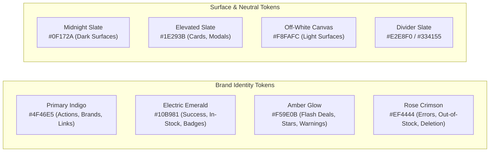
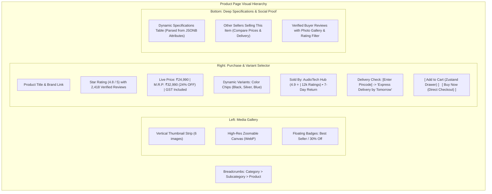
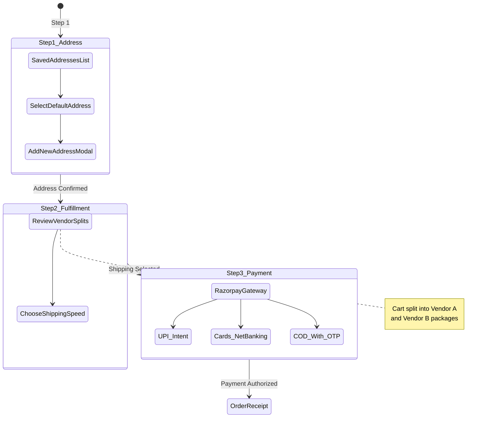

# 🎨 Design System & UI/UX Architecture Specification — ApexBazaar

**Document Version:** 1.0.0  
**Status:** Under Review / Ratified  
**Author:** Product Design & Frontend Architecture Team  
**Design Paradigm:** High-Contrast Utility-First Design with Dark/Light Tokens  

---

## 1. Design System Foundations & Design Tokens

ApexBazaar employs a bespoke, accessible, and high-performance design language engineered for fluid responsiveness across desktop, tablet, and mobile devices.

### 1.1 Color Palette & Semantic Tokens



| Semantic Role | Token Name | Light Mode Value | Dark Mode Value | Usage Context |
| :--- | :--- | :--- | :--- | :--- |
| **Primary Action** | `--color-primary` | `#4F46E5` (Indigo-600) | `#6366F1` (Indigo-500) | Main CTA buttons, active tabs, links |
| **Primary Hover** | `--color-primary-hover` | `#4338CA` (Indigo-700) | `#4F46E5` (Indigo-600) | Button hover & focus states |
| **Success / Trust** | `--color-success` | `#059669` (Emerald-600) | `#10B981` (Emerald-500) | Verified Seller badge, in-stock tag, delivery success |
| **Warning / Promo** | `--color-warning` | `#D97706` (Amber-600) | `#F59E0B` (Amber-500) | Flash sale banners, limited stock warning, review stars |
| **Danger / Alert** | `--color-danger` | `#DC2626` (Red-600) | `#EF4444` (Red-500) | Form errors, out-of-stock tag, return cancellation |
| **Background Base** | `--color-bg-base` | `#F8FAFC` (Slate-50) | `#0B0F19` (Slate-950) | Root application background canvas |
| **Background Card** | `--color-bg-surface` | `#FFFFFF` (Pure White) | `#1E293B` (Slate-800) | Product cards, drawers, modal sheets |
| **Text Primary** | `--color-text-primary`| `#0F172A` (Slate-900) | `#F8FAFC` (Slate-50) | Main headlines, product titles, prices |
| **Text Secondary** | `--color-text-muted` | `#64748B` (Slate-500) | `#94A3B8` (Slate-400) | Metadata, breadcrumbs, specifications |
| **Border / Divider**| `--color-border` | `#E2E8F0` (Slate-200) | `#334155` (Slate-700) | Card borders, input field borders, table lines |

---

### 1.2 Typography & Scale
- **Primary Typeface:** `Inter`, `Plus Jakarta Sans` (sans-serif) for high legibility on small mobile viewports.
- **Monospace Typeface:** `JetBrains Mono` for order IDs (`#APX-98231`), tracking AWBs, and SKU codes.
- **Scale Hierarchy:**
  - `text-xs` (12px / 16px line-height): Tags, category chips, rating count.
  - `text-sm` (14px / 20px line-height): Body text, form labels, specs table.
  - `text-base` (16px / 24px line-height): Standard product descriptions, buttons.
  - `text-lg` (18px / 28px line-height): Card headers, drawer subheadings.
  - `text-xl` (20px / 28px line-height): Section headers, modal titles.
  - `text-2xl` (24px / 32px line-height): Product display titles, page headers.
  - `text-3xl` (30px / 36px line-height): Hero banner headlines, promotional callouts.

---

## 2. React Component Ecosystem & Library Stack

The frontend client is built exclusively using modern, accessible, and lightweight React libraries:

| Capability | Library / Tool | Version | Architectural Justification |
| :--- | :--- | :--- | :--- |
| **UI Framework** | React + TypeScript | `v19.0.0` | Strict type safety, improved concurrent rendering, zero memory leaks. |
| **Build Tooling** | Vite | `v6.0.0` | Ultra-fast HMR (<100ms), Rollup tree-shaking production bundling. |
| **CSS Framework** | Tailwind CSS v4 | `v4.0.0` | High-speed compiler, dynamic CSS variables, zero unused runtime CSS. |
| **Iconography** | Lucide React | `v1.25.0` | Tree-shakeable, consistent 24px SVG icons with configurable stroke. |
| **Animations** | Framer Motion | `v14.0.0` | Smooth spring-physics animations for drawers, modals, and toasts. |
| **Accessible Primitives**| Radix UI / Headless UI| `Latest` | WAI-ARIA compliant unstyled dialogs, popovers, dropdowns, and sliders. |
| **Form Management** | React Hook Form + Zod | `v7.89.0` | Uncontrolled high-performance inputs with schema-validated error boundaries. |
| **Server State** | TanStack Query | `v5.0.0` | Optimistic mutations, background caching, query deduplication. |
| **Client State** | Zustand | `v5.0.15` | Minimalist (<1kB), hook-based state for cart drawers, auth modal, theme. |
| **Notifications** | React Hot Toast / Sonner| `v2.6.1` | Accessible stacked toast messages for cart updates and order notifications. |

---

## 3. Core Page Specifications & UI Layouts

### 3.1 Storefront Homepage Layout
The homepage balances high-velocity search discovery with promotional conversion rails.

```
+-----------------------------------------------------------------------------------+
| [Brand Logo: ApexBazaar]  [ Pincode: 560001 v ]  [ Search 100k+ Products... [Q] ] |
| [ Deals ] [ Categories v ] [ Become a Seller ]  [ Wishlist (3) ]  [ Cart (2) ₹1,499 ]|
+-----------------------------------------------------------------------------------+
| Category Rail: [Electronics] [Fashion] [Grocery] [Home] [Beauty] [Toys] [Books]... |
+-----------------------------------------------------------------------------------+
| >>> HERO CAROUSEL: "Mega Electronics Fest: Up to 50% Off Top Brands" [Shop Now]   |
+-----------------------------------------------------------------------------------+
| [⚡ Flash Deals Live]  Ends in [ 04 : 18 : 32 ]                     [ View All -> ] |
|  +--------------+  +--------------+  +--------------+  +--------------+           |
|  | [Image] -40% |  | [Image] -25% |  | [Image] -50% |  | [Image] -30% |           |
|  | Sony WH-1000 |  | Nike Air Max |  | Apple iPad   |  | Organic Tea  |           |
|  | ₹19,990      |  | ₹6,499       |  | ₹32,900      |  | ₹299         |           |
|  | [Add to Cart]|  | [Add to Cart]|  | [Add to Cart]|  | [Add to Cart]|           |
|  +--------------+  +--------------+  +--------------+  +--------------+           |
+-----------------------------------------------------------------------------------+
| [🏷️ Multi-Vendor Spotlight: Verified Artisan Sellers]                              |
|  [Seller A: Jaipur Weaves]   [Seller B: Kerala Spices]   [Seller C: TechPro Audio] |
+-----------------------------------------------------------------------------------+
```

#### Key Functional Elements
- **Instant Search Input:** Sticky top header with embedded clear button, voice-search shortcut, and live auto-complete dropdown triggered at `length >= 2`.
- **Location & Pincode Selector:** Stores customer's active delivery pincode to dynamically calculate delivery eligibility and estimated delivery dates directly on cards.
- **Category Nav Rail:** Horizontal scrollable rail of category icons with hover popover menus revealing nested subcategories.

---

### 3.2 Category & Search Results Page (PLP)
Optimized for high-precision faceted filtering across 100k+ catalog items.

```
+-----------------------------------------------------------------------------------+
| Breadcrumbs: Home > Electronics > Audio > Headphones                   (1,420 items)|
+-----------------------------+-----------------------------------------------------+
| FILTERS (Clear All)         | Active Chips: [Wireless X] [Sony X] [Under ₹15,000 X]|
|                             | Sort By: [ Relevance v | Price: Low-High | Rating ] |
| Price Range                 +-----------------------------------------------------+
| [=====O----------] ₹500-₹20k| [Card 1]                     [Card 2]               |
|                             | +--------------------------+ +--------------------+ |
| Brand                       | | [Image Gallery 1/4]      | | [Image]            | |
| [x] Sony (142)              | | Sony WH-1000XM5 ANC      | | Bose QuietComfort  | |
| [ ] Bose (84)               | | ⭐ 4.8 (2,410) Verified   | | ⭐ 4.7 (1,890)     | |
| [ ] Sennheiser (61)         | | ₹26,990  M.R.P: ₹34,990   | | ₹24,990            | |
|                             | | Sold by: CloudAudio (4.9)| | Sold by: SoundHub  | |
| Dynamic Specs (JSONB)       | | [🚚 Free Next-Day Delivery]| | [🚚 2-Day Delivery]| |
| Battery Life: [x] > 20h     | | [ Add to Cart ] [❤️]      | | [ Add to Cart ] [❤️]| |
| Connectivity: [x] Bluetooth | +--------------------------+ +--------------------+ |
| Driver Size: [ ] 40mm       |                                                     |
|                             | [Card 3]                     [Card 4]               |
| Seller Rating               | ...                          ...                    |
| [ ] 4.5 Stars & Above       +-----------------------------------------------------+
|                             | Pagination: [ < Prev ] [ 1 ] [ 2 ] [ 3 ] ... [ Next >]|
+-----------------------------+-----------------------------------------------------+
```

---

### 3.3 Product Details Page (PDP)
A high-converting product page highlighting multi-vendor offers, dynamic JSONB specs, and seller credentials.



---

### 3.4 Slide-Over Shopping Cart Drawer & Checkout Wizard

#### A. Slide-Over Cart Drawer
- **Trigger:** Accessible anywhere via header cart pill; triggers smooth right-side slide-over with backdrop blur.
- **Multi-Vendor Partitioning:** Items grouped by seller name with independent dispatch estimates.
- **Dynamic Shipping Meter:** "Add ₹499 more from *Seller A* to unlock FREE Shipping".
- **Cart Item Component:** Thumbnail, product title, chosen variant chips, quantity stepper (`-`, `1`, `+`), line-item price, and remove trash icon.
- **Sticky Summary Footer:**
  - Subtotal calculation
  - Dynamic coupon input (`APEX10`)
  - Estimated GST (18%)
  - Total Payable amount
  - Prominent "Proceed to Split Checkout" CTA.

#### B. 3-Step Checkout Wizard


---

### 3.5 Seller Portal Dashboard (`/seller`)
Engineered as an enterprise operational workstation for merchants:
- **Top Metrics Ribbon:** Today's GMV, Unsettled Escrow Balance, New Orders Pending Acceptance, In-Transit Packages, Return Dispute Rate.
- **Fulfillment Kanban Board:** Columns for `New Orders` → `Ready for Packing` → `Ready for Pickup (AWB Generated)` → `In-Transit` → `Delivered`.
- **Dynamic Catalog Builder:** Dynamic form fields automatically rendered based on chosen category JSONB schema (e.g., selecting "Sneakers" dynamically spawns EU/UK Size pickers and Sole Material dropdowns).
- **Escrow Settlement Ledger:** Real-time ledger showing gross order value, platform commission deduction (e.g. 10%), logistics deduction, GST TCS (1%), and exact release date.

---

### 3.6 Super Admin Governance Hub (`/admin`)
- **System Telemetry:** Real-time throughput, active concurrent shoppers, server health, Meilisearch latency.
- **Seller Verification Queue:** Split-screen verification view: left side displays seller submitted GSTIN/PAN and bank passbook image; right side validates live via GST portal API with one-click `Approve` or `Reject with Reason`.
- **Commission Matrix Engine:** Interactive table allowing admins to set platform commission rates globally, per category, or per specific vendor contract.
- **Dispute Arbitration Desk:** Customer vs. Seller return conflict resolution tool with timeline audit and one-click escrow debit/refund override.

---

## 4. Accessibility (a11y) & Responsive Engineering Standards

### 4.1 Accessibility Standards (WCAG 2.1 AA)
- **Contrast Ratios:** Minimum contrast ratio of **4.5:1** for standard text and **3:1** for large headlines and UI icons against background canvas.
- **Keyboard Navigation:** All interactive elements (buttons, sliders, modals, tabs) maintain clear `:focus-visible` outline rings (`2px solid var(--color-primary)` with `2px offset`).
- **Screen Reader Semantics:**
  - Dynamic modals and drawers use `aria-modal="true"` and trap focus until dismissed.
  - Price updates and cart count adjustments emit `aria-live="polite"` announcements.
  - All icon-only buttons include descriptive `aria-label` attributes (e.g., `aria-label="Remove item from cart"`).

### 4.2 Responsive Breakpoints & Adaptations

| Breakpoint Name | Media Query | Layout Adaptations |
| :--- | :--- | :--- |
| **Mobile (`sm`)** | `< 640px` | Single column product feed, bottom fixed checkout navigation bar, full-screen filter bottom-sheet, swipeable image carousels. |
| **Tablet (`md`)** | `640px – 1023px` | 2-3 column product grid, collapsed sidebar navigation, collapsible cart drawer. |
| **Desktop (`lg`)** | `1024px – 1279px` | 4-column product grid, sticky left-hand faceted filter sidebar, split-screen PDP layout. |
| **Wide Desktop (`xl`)** | `≥ 1280px` | 5-column product grid, expanded seller dashboard data tables with pinned action columns. |

