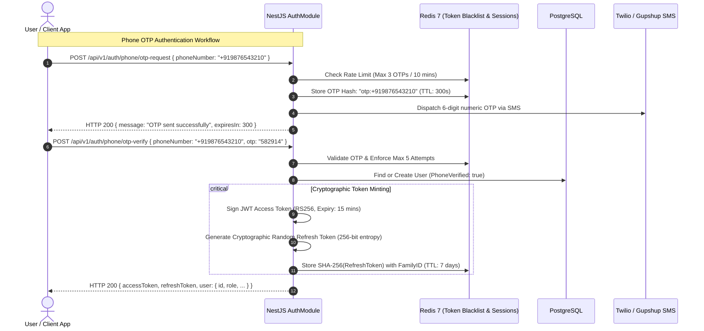
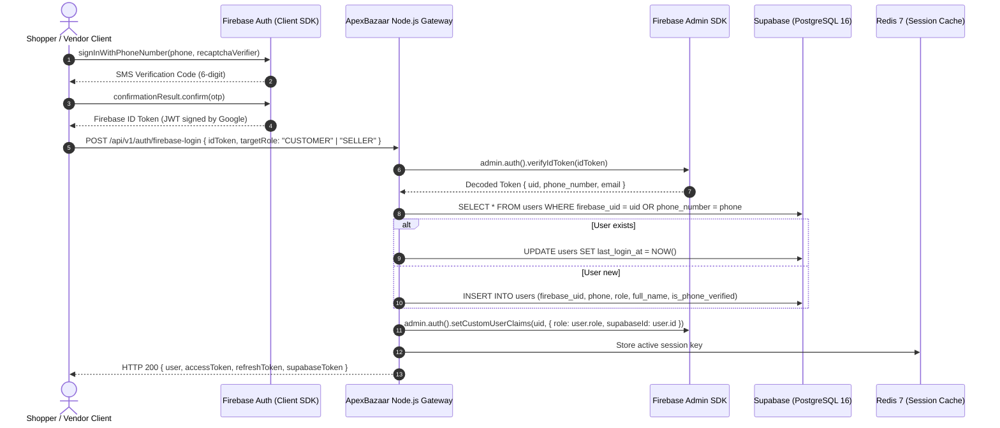
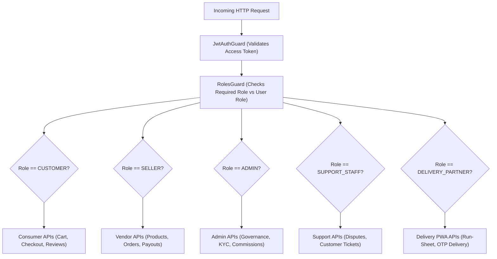
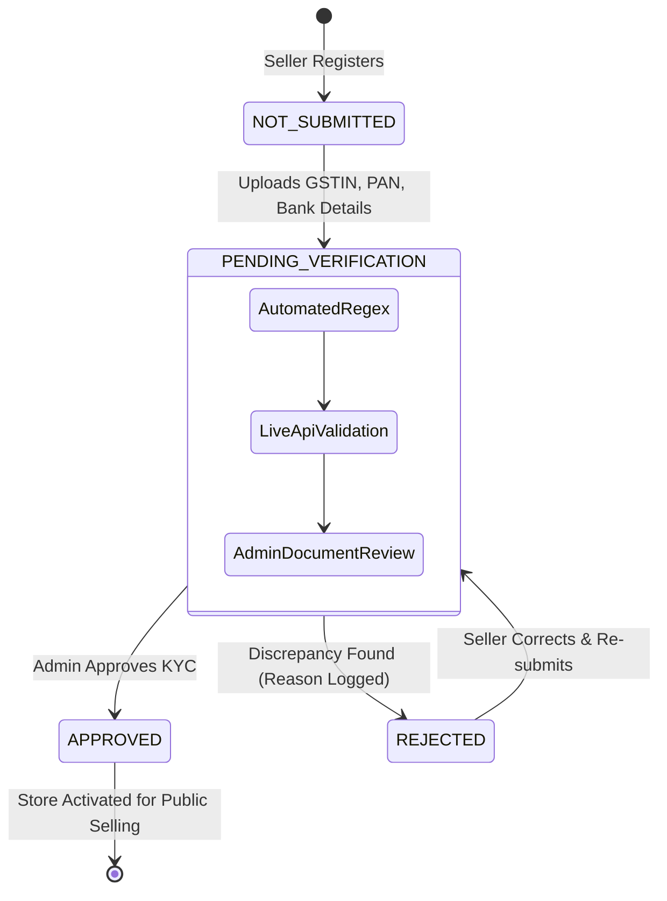

# 🔐 Authentication, Authorization & Security Architecture — ApexBazaar

**Document Version:** 1.0.0  
**Status:** Under Review / Ratified  
**Author:** Principal Security Architect & Backend Engineering Team  
**Standards:** OAuth 2.0, OpenID Connect, NIST SP 800-63B, OWASP Top 10:2021  

---

## 1. Authentication Architecture & Token Lifecycle

ApexBazaar implements a stateless, dual-token cryptographic authentication scheme utilizing short-lived **JWT Access Tokens** and stateful, rotating **Redis-backed Refresh Tokens**.



### 1.1 Token Specifications & Payloads

#### A. JWT Access Token (Short-Lived)
- **Lifetime:** 15 Minutes (`exp = iat + 900`).
- **Signature Algorithm:** `RS256` (Asymmetric RSA-SHA256 with 2048-bit key) or `HS256` with rotating secret in staging.
- **Claims Schema:**
  ```json
  {
    "sub": "usr_9b1deb4d-3b7d-4bad-9bdd-2b0d7b3dcb6d",
    "role": "SELLER",
    "sellerProfileId": "sel_7a2cf1e8-1c3e-4b2a-89a1-5d9c8e7b1a23",
    "isPhoneVerified": true,
    "email": "vendor@jaipurhandlooms.com",
    "iss": "https://api.apexbazaar.com",
    "aud": "https://apexbazaar.com",
    "iat": 1793400000,
    "exp": 1793400900
  }
  ```

#### B. Rotating Refresh Token (Single-Use with Reuse Detection)
- **Format:** 64-character hexadecimal cryptographically secure random string (`crypto.randomBytes(32).toString('hex')`).
- **Storage Strategy:** Hashed via SHA-256 in Redis under `refresh_token:{hashedToken}` with associated metadata:
  ```json
  {
    "userId": "usr_9b1deb4d-3b7d-4bad-9bdd-2b0d7b3dcb6d",
    "familyId": "fam_e4d9c82b-4f1a-4c92-8e71-9b8a7c6d5e4f",
    "generation": 2,
    "ipAddress": "203.0.113.195",
    "userAgent": "Mozilla/5.0 ...",
    "expiresAt": 1794004800
  }
  ```
- **Reuse Detection Safeguard:** If an already-consumed refresh token is presented (e.g., token stolen by adversary), Redis detects that `generation < family.currentGeneration`. The entire token family is immediately revoked, forcing all active sessions for that user to terminate.

---

## 2. Multi-Method Authentication Workflows

### 2.1 Firebase Authentication & Phone OTP Login (Primary for India)
ApexBazaar leverages **Firebase Authentication** alongside our server-authoritative Supabase backend to deliver reliable, carrier-grade Phone OTP login with built-in reCAPTCHA verification, zero carrier degradation, and seamless multi-factor auth:



1. **Client Flow:** Frontend uses Firebase JS SDK (`signInWithPhoneNumber`) with invisible reCAPTCHA for spam/bot mitigation.
2. **Server Verification:** The resulting Firebase ID token is transmitted via `Authorization: Bearer <firebase_id_token>` to `POST /api/v1/auth/firebase-login`.
3. **Identity Synchronization:** The backend initializes `firebase-admin` to cryptographically verify the token, then links or provisions the record in **Supabase PostgreSQL** `users` table via `firebase_uid`.
4. **Firebase Custom User Claims:** The server assigns custom claims (`admin.auth().setCustomUserClaims(uid, { role: user.role, supabaseUserId: user.id })`) granting immediate role propagation across Firestore and Firebase Storage security rules.
5. **Fallback Native Phone OTP:** For headless API or legacy clients, `POST /api/v1/auth/phone/otp-request` dispatches via Twilio/Gupshup and stores hashed OTPs in Redis (5-minute TTL, max 3 attempts).

### 2.2 Email & Password (Traditional)
1. **Password Hashing:** **Argon2id** (OWASP recommended parameters: Memory 64MB, Iterations 3, Parallelism 1).
2. **Password Policy:**
   - Minimum 8 characters, maximum 128 characters.
   - At least 1 uppercase letter (`A-Z`).
   - At least 1 lowercase letter (`a-z`).
   - At least 1 decimal digit (`0-9`).
   - At least 1 special character (`!@#$%^&*()_+-=[]{}|;:,.<>?`).
   - Checked against HaveIBeenPwned common compromised password list.

### 2.3 Social OAuth2 Login (Firebase Google & Apple)
1. Client initiates Google/Apple OAuth popup via `signInWithPopup(auth, googleProvider)`.
2. Obtained Firebase ID token is presented to `POST /api/v1/auth/firebase-login`.
3. Backend validates signature with Firebase Admin SDK, maps to Supabase `User`, assigns role claims, and returns unified session payload.

---

## 3. Role-Based Access Control (RBAC) Matrix

ApexBazaar enforces strict authorization boundaries across 5 distinct system personas.



### Granular Resource Permission Matrix

| Resource Domain | Operations | Customer | Seller | Admin | Support Staff | Delivery Partner |
| :--- | :--- | :---: | :---: | :---: | :---: | :---: |
| **Catalog Browsing** | View Categories, Products, Reviews | ✅ Read | ✅ Read | ✅ Read | ✅ Read | ✅ Read |
| **Product Management** | Create, Update, Delete own SKUs | ❌ Denied | ✅ Write (Own) | ✅ Full | ❌ Denied | ❌ Denied |
| **Cart & Checkout** | Add items, Create Master Order | ✅ Full (Own) | ❌ Denied | ❌ Denied | ❌ Denied | ❌ Denied |
| **Sub-Order Fulfillment** | Accept, Pack, Generate Label | ❌ Denied | ✅ Write (Own) | ✅ Full | 👁️ Read-Only | ❌ Denied |
| **Doorstep Delivery** | Run-sheet view, Verify Delivery OTP | ❌ Denied | ❌ Denied | 👁️ Read-Only | 👁️ Read-Only | ✅ Write (Assigned) |
| **Seller KYC** | Submit KYC, View Status | ❌ Denied | ✅ Write (Own) | ✅ Full (Approve/Reject)| 👁️ Read-Only | ❌ Denied |
| **Disputes & Returns** | Initiate Return, Inspect Goods | ✅ (Initiate) | ✅ (Inspect) | ✅ (Arbitrate) | ✅ (Arbitrate) | ❌ Denied |
| **Escrow & Payouts** | View Ledger, Trigger Payouts | ❌ Denied | 👁️ Read (Own) | ✅ Full | 👁️ Read-Only | ❌ Denied |
| **Commission Engine** | Configure Platform Take-Rates | ❌ Denied | ❌ Denied | ✅ Full | ❌ Denied | ❌ Denied |
| **Audit Logs** | View System Security Trails | ❌ Denied | ❌ Denied | ✅ Full | ❌ Denied | ❌ Denied |

---

## 4. Seller KYC Verification Security & Workflow

Sellers cannot publish products or receive payouts until KYC verification is formally completed.



### 4.1 Verification Checks
1. **GSTIN Validation:** 15-character alphanumeric format validated via official GST checksum algorithm (`^[0-9]{2}[A-Z]{5}[0-9]{4}[A-Z]{1}[1-9A-Z]{1}Z[0-9A-Z]{1}$`).
2. **PAN Verification:** 10-character alphanumeric regex (`^[A-Z]{5}[0-9]{4}[A-Z]{1}$`).
3. **Bank Account Verification:** IFSC code checked against RBI clearing house database; penny-drop verification via Razorpay Fund Accounts API to match account holder name with legal business entity.
4. **Document Storage:** Business registration certificates and cancelled cheques uploaded to **Firebase Cloud Storage / Supabase Storage** private buckets (`kyc-documents/{sellerId}/{docId}`). Access is governed by custom security rules and short-lived signed URLs generated strictly for Admin review. Public read access is permanently disabled.

---

## 5. OWASP Top 10 Defense Architecture

| Threat (OWASP 2021) | Defense Strategy in ApexBazaar | Implementation Details |
| :--- | :--- | :--- |
| **A01: Broken Access Control** | Attribute-based scoping & NestJS Guards | Controllers enforce `@UseGuards(JwtAuthGuard, RolesGuard)`. Sub-order operations verify `subOrder.sellerId === req.user.sellerProfileId`. |
| **A02: Cryptographic Failures** | TLS 1.3 everywhere, Argon2id, AES-256 | Data encrypted at rest in PostgreSQL and S3; all external communication enforced over HTTPS with HSTS headers. |
| **A03: Injection** | Parameterized Prisma ORM, strict input DTOs | Zero raw SQL queries; all HTTP request payloads validated using `class-validator` with `whitelist: true, forbidNonWhitelisted: true`. |
| **A04: Insecure Design** | Rate limiting, circuit breakers, idempotency | Financial endpoints enforce idempotency keys (`Idempotency-Key: <UUID>`); payment operations use distributed Redis locks. |
| **A05: Security Misconfiguration** | Helmet security headers, CORS origin whitelist | Express/NestJS configured with `helmet()`: disables `X-Powered-By`, sets `Content-Security-Policy`, `X-Frame-Options: DENY`. |
| **A06: Vulnerable Components** | Automated CI scanning, Dependabot | GitHub Actions runs `npm audit --audit-level=high` and Snyk container image scanning on every pull request. |
| **A07: Identification & Auth** | Dual-token rotation, OTP rate-limiting | Account lockout after 5 consecutive failed OTP/password attempts; token reuse detection in Redis. |
| **A08: Software & Data Integrity**| Webhook HMAC signatures | Razorpay and Shiprocket webhooks validated via `crypto.createHmac('sha256', secret)` before parsing. |
| **A09: Logging & Monitoring** | Winston JSON logs + Sentry APM | All security events (failed logins, KYC decisions, payout releases) logged with correlation IDs; PII (passwords, cards) masked. |
| **A10: Server-Side Request Forgery**| Outbound URL allowlisting | Media image imports (e.g. seller catalog CSV import) strictly validated against permitted MIME types and non-internal IP addresses. |

---

## 6. Rate Limiting & Abuse Prevention (Redis Token Bucket)

Rate limiting is enforced at the Nginx reverse proxy and NestJS API gateway using a Redis sliding-window token bucket algorithm:

```typescript
// Sample NestJS Rate Limiting Configuration (ThrottlerModule)
ThrottlerModule.forRoot([
  {
    name: 'short',
    ttl: 1000,
    limit: 10, // Max 10 requests per second per IP
  },
  {
    name: 'auth_endpoints',
    ttl: 60000,
    limit: 5,  // Max 5 login/OTP requests per minute per IP
  },
  {
    name: 'customer_api',
    ttl: 60000,
    limit: 120, // Max 120 requests per minute for authenticated shoppers
  },
  {
    name: 'seller_api',
    ttl: 60000,
    limit: 300, // Max 300 requests per minute for active seller inventory sync
  }
])
```

- When limits are exceeded, the API responds with **HTTP 429 Too Many Requests** and headers:
  - `Retry-After: 35`
  - `X-RateLimit-Limit: 5`
  - `X-RateLimit-Remaining: 0`
  - `X-RateLimit-Reset: 1793400035`

