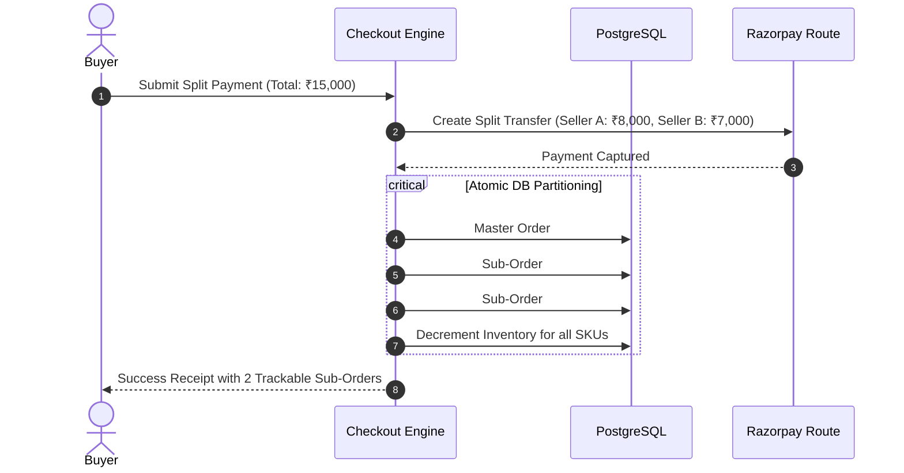

# 📦 Feature Specifications, Acceptance Criteria & Edge Cases — ApexBazaar

**Document Version:** 1.0.0  
**Status:** Under Review / Ratified  
**Author:** Technical Architecture & QA Automation Squad  
**Standard:** Behavioral-Driven Specification (Gherkin Given-When-Then & Edge-Case Playbooks)  

---

## 1. Multi-Category Catalog & Dynamic Attributes (JSONB)

### 1.1 Specification & Acceptance Criteria
- **Description:** Allows categories across diverse retail verticals (Electronics, Fashion, Grocery, Books, Home, etc.) to enforce dynamic, domain-specific specifications without requiring schema alterations.
- **Scenario: Listing a Variant with Dynamic Attributes**
  - **Given** an approved seller in the "Fashion > Men's Apparel" category,
  - **When** the seller creates a SKU with attributes `{"size": "XL", "color": "Navy Blue", "fabric": "100% Organic Cotton"}`,
  - **Then** the backend validates the JSON against the category's `attributeSchema`,
  - **And** generates a searchable variant SKU with GIN indexing,
  - **And** updates the Meilisearch index within < 500ms.

### 1.2 Edge Cases & Mitigations
| Edge Case ID | Scenario | System Behavior & Mitigation |
| :--- | :--- | :--- |
| **EC-CAT-01** | **Category Schema Evolution** Admin adds a new mandatory attribute (e.g., "Energy Star Rating" for Air Conditioners) to an existing category with 5,000 active listings. | Existing SKUs are grandfathered with status `COMPLIANCE_REVIEW_REQUIRED`. New listings or SKU updates are strictly blocked until the new attribute is provided. Admin dashboard reports legacy non-compliant SKUs. |
| **EC-CAT-02** | **Deeply Nested Categories & Circular References** Admin attempts to set a category's parent to itself or one of its descendants. | Prisma validation hook rejects updates where `parentId IN (SELECT descendant_ids)`. Category tree depth hard-capped at 4 levels. |
| **EC-CAT-03** | **Malformed JSONB Payloads via Bulk CSV/API** Seller uploads strings where numbers are expected (e.g., `"weight": "two kg"` instead of `2.0`). | Zod schema validator parses and coerces types; if coercion fails, row is flagged in bulk upload error manifest with exact line and column number. |

---

## 2. Advanced Search & Dynamic Faceted Filters (Meilisearch)

### 2.1 Specification & Acceptance Criteria
- **Scenario: Typo-Tolerant Faceted Search**
  - **Given** a buyer searches for `"smashng glaxy phon"` with active price filter `[₹10,000 - ₹40,000]`,
  - **When** the query reaches the Meilisearch cluster,
  - **Then** Meilisearch matches `"Samsung Galaxy Phone"` within 2-character edit distance,
  - **And** returns matching SKUs within the price bounds in < 30ms,
  - **And** dynamically renders facet counts for available RAM, Storage, and Seller ratings.

### 2.2 Edge Cases & Mitigations
| Edge Case ID | Scenario | System Behavior & Mitigation |
| :--- | :--- | :--- |
| **EC-SRC-01** | **Zero Search Results on Long-Tail Queries** Buyer inputs a hyper-specific phrase returning 0 hits. | The search engine automatically drops the least significant token (e.g. falls back from "red silk embroidered sari 40 inch" to "red silk sari") and returns "Showing results for *red silk sari* instead". |
| **EC-SRC-02** | **Ghost Listing Due to Search Desync** Product deleted or stock drops to 0 in PostgreSQL, but search index still shows item as available. | Checkout performs an atomic database stock validation. If stock is 0, the checkout gracefully alerts the user, automatically triggers an immediate Meilisearch index sync via BullMQ, and updates client UI. |
| **EC-SRC-03** | **Special Characters & SQL/XSS Injection in Search Bar** Attacker enters `'; DROP TABLE products; --` or ``. | Query string is sanitized, stripped of script tags, and passed strictly as a text parameter to Meilisearch query builder. Zero raw query concatenation. |

---

## 3. Shopping Cart Engine (Guest + Authenticated Persistence)

### 3.1 Specification & Acceptance Criteria
- **Scenario: Guest Cart Synchronization on Login**
  - **Given** a guest shopper has 2 items in their local browser cart,
  - **And** an existing registered account has 1 item previously saved in Redis,
  - **When** the guest successfully logs in via Phone OTP,
  - **Then** the system automatically merges the guest items with the account cart,
  - **And** increments quantities for matching SKUs up to the maximum available seller stock,
  - **And** recalculates multi-vendor delivery groupings and free shipping meters.

### 3.2 Edge Cases & Mitigations
| Edge Case ID | Scenario | System Behavior & Mitigation |
| :--- | :--- | :--- |
| **EC-CRT-01** | **Price Fluctuations While Item in Cart** Seller changes price from ₹999 to ₹1,299 while the item sits in buyer's cart for 3 days. | When cart is viewed or checkout initiated, price is revalidated against database. A prominent banner displays: *"Item 'X' price changed from ₹999 to ₹1,299"*. Checkout proceeds only upon user re-confirmation. |
| **EC-CRT-02** | **Simultaneous Cart Addition of Last Inventory Item** Two shoppers add the last available unit of a rare SKU to cart at the same second. | Adding to cart does **not** lock stock (to prevent cart-hoarding denial-of-service). Stock is locked only upon initiating payment intent via Redis Redlock (15-minute hold). The first buyer to complete payment wins the item; the second is alerted. |

---

## 4. Multi-Seller Split Checkout & Payment Escrow

### 4.1 Specification & Acceptance Criteria
- **Scenario: Multi-Vendor Order Partitioning & Escrow Authorization**
  - **Given** a cart containing items from *Seller A (Bangalore)* and *Seller B (Delhi)*,
  - **When** the buyer pays ₹15,000 via Razorpay UPI,
  - **Then** the payment gateway creates a single transaction charge,
  - **And** the backend database atomically creates 1 Master Order and 2 independent Sub-Orders,
  - **And** sets both Sub-Orders to status `PENDING_CONFIRMATION` with escrow status `HELD`,
  - **And** assigns distinct delivery tracking IDs and dispatch deadlines to each seller.

### 4.2 Edge Cases & Mitigations
| Edge Case ID | Scenario | System Behavior & Mitigation |
| :--- | :--- | :--- |
| **EC-CHK-01** | **Network Drop During Payment Webhook Callback** Buyer's bank debits amount, but buyer closes browser before redirect; webhook is delayed by 10 minutes. | The checkout UI polls `GET /orders/status/:paymentIntentId` every 2 seconds. When Razorpay webhook hits backend with valid HMAC signature, idempotency key ensures Master Order and Sub-orders are created exactly once. When user reopens app, order is marked `PAID`. |
| **EC-CHK-02** | **One Seller Rejects / Out of Stock on Sub-Order** Seller A accepts order, but Seller B discovers their stock was damaged in warehouse and cancels. | Seller B's sub-order is marked `CANCELLED`. System triggers an immediate partial refund for Seller B's portion back to customer's source account via Razorpay API. Seller A's sub-order continues fulfillment without interruption. |

---

## 5. Coupons, Deals & Promotional Engine

### 5.1 Specification & Acceptance Criteria
- **Scenario: Application of Category-Restricted Coupon**
  - **Given** an active promo code `FASHION20` (20% off Fashion items, min spend ₹1,500, max discount ₹500),
  - **When** the buyer has ₹2,000 of Fashion items and ₹1,000 of Electronics in cart,
  - **Then** the discount is calculated strictly on the eligible Fashion items (`20% of ₹2,000 = ₹400`),
  - **And** total payable amount is reduced by ₹400,
  - **And** platform absorbs the discount unless flagged as seller-funded in the coupon rules.

### 5.2 Edge Cases & Mitigations
| Edge Case ID | Scenario | System Behavior & Mitigation |
| :--- | :--- | :--- |
| **EC-CPN-01** | **Order Total Drops Below Minimum Spend After Return** Buyer used ₹500 coupon (min spend ₹3,000) on a ₹3,500 order. Buyer returns an item worth ₹1,000, bringing net retained order to ₹2,500. | The refund calculation engine prorates coupon discounts across all items based on price weighting. Refund amount = `Returned Item Price - Prorated Coupon Discount`. Buyer cannot exploit return to get coupon value on sub-threshold spend. |
| **EC-CPN-02** | **Concurrent Coupon Exploitation** A limited coupon (first 100 users) is submitted by 250 users simultaneously during a flash sale. | Redis `INCR` operation executes atomically on coupon key `coupon:usage:<code_id>`. Once counter reaches 100, subsequent transactions are rejected immediately at the Redis layer before DB write. |

---

## 6. Order Tracking & Real-Time Logistics Fulfillment

### 6.1 Specification & Acceptance Criteria
- **Scenario: Doorstep OTP Delivery Verification**
  - **Given** an assigned delivery partner arriving at the customer's delivery address,
  - **When** the driver enters the customer's secret 4-digit OTP into the Delivery PWA,
  - **Then** the backend validates the SHA-256 hash of the OTP against the database,
  - **And** marks the shipment and sub-order as `DELIVERED`,
  - **And** sets the `escrowReleaseDate = NOW() + INTERVAL '7 DAYS'`,
  - **And** triggers SMS delivery confirmation and customer review invitation.

### 6.2 Edge Cases & Mitigations
| Edge Case ID | Scenario | System Behavior & Mitigation |
| :--- | :--- | :--- |
| **EC-LOG-01** | **Customer Phone Dead / OTP Not Received at Doorstep** Buyer cannot retrieve SMS OTP due to mobile network issue. | Driver PWA offers "Resend OTP via WhatsApp / Email" button. If entirely unreachable, fallback allows delivery partner to call a toll-free IVR or trigger supervisor emergency override with customer photo proof. |
| **EC-LOG-02** | **Failed Delivery Attempts (RTO - Return to Origin)** Customer address incorrect or customer repeatedly unavailable across 3 scheduled attempts. | On 3rd failed attempt, 3PL carrier marks status `RTO_INITIATED`. Item routes back to seller warehouse. Once seller confirms package receipt, customer receives refund minus non-refundable outbound shipping charges. |

---

## 7. Itemized Returns, Replacements & Escrow Refunds

### 7.1 Specification & Acceptance Criteria
- **Scenario: Self-Serve Defective Product Return**
  - **Given** a delivered order within the 7-day category return window,
  - **When** customer selects "Damaged / Defective Item", uploads 2 clear photos, and submits return,
  - **Then** a `ReturnRequest` record is created,
  - **And** an automated reverse logistics pickup AWB is booked via Shiprocket,
  - **And** seller escrow release timer is suspended with status `DISPUTED`.

### 7.2 Edge Cases & Mitigations
| Edge Case ID | Scenario | System Behavior & Mitigation |
| :--- | :--- | :--- |
| **EC-RET-01** | **Seller Fraudulent Rejection of Valid Return** Seller receives returned package and claims "customer returned an empty box/wrong item" to block refund. | System triggers a dispute arbitration ticket. Both buyer and seller must upload unboxing/inspection videos. ApexBazaar Support Staff arbitrates within 48 hours using the Admin Dispute Desk. |
| **EC-RET-02** | **Return Window Expired** Buyer attempts to click return button on Day 8 after delivery on a 7-day return policy category. | Return button in UI is disabled with tooltip *"Return window closed on [Date]"*. API strictly enforces `WHERE delivered_at + INTERVAL '7 DAYS' >= NOW()`, returning HTTP 403. |

---

## 8. Reviews, Ratings & Anti-Fraud UGC Moderation

### 8.1 Specification & Acceptance Criteria
- **Scenario: Verified Purchase Review Submission**
  - **Given** an authenticated user who completed purchase and delivery of SKU `X`,
  - **When** user submits a 5-star rating, review title, and attached photo,
  - **Then** the system verifies purchase history (`isVerifiedPurchase = true`),
  - **And** passes text and media through the automated AI moderation worker,
  - **And** recalculates the product's running Bayesian average rating upon approval.

### 8.2 Edge Cases & Mitigations
| Edge Case ID | Scenario | System Behavior & Mitigation |
| :--- | :--- | :--- |
| **EC-REV-01** | **Competitor Review Bombing / Defamation Attack** Malicious actor orchestrates 50 fake 1-star reviews using bot accounts. | Non-buyers cannot submit reviews. For verified buyers, velocity anomaly detection flags accounts reviewing > 5 products in under 10 minutes. Flagged reviews quarantined for human moderator approval. |
| **EC-REV-02** | **Explicit / Inappropriate Image Upload in Reviews** User attaches adult, copyrighted, or offensive imagery. | S3 upload triggers AWS Rekognition / Google Cloud Vision moderation lambda. Images exceeding moderate content safety thresholds are blocked and deleted before rendering publicly. |

---

## 9. Seller Dashboard, Inventory Management & Escrow Payouts

### 9.1 Specification & Acceptance Criteria
- **Scenario: Automated T+7 Escrow Payout Settlement**
  - **Given** a sub-order marked `DELIVERED` exactly 7 days ago without open disputes,
  - **When** the BullMQ settlement cron runs at 02:00 AM IST,
  - **Then** the worker calculates `Net Payout = Subtotal + Tax - Commission - 1% TCS`,
  - **And** executes transfer via Razorpay Route to seller's verified bank account,
  - **And** generates a downloadable GST compliance credit note and invoice.

### 9.2 Edge Cases & Mitigations
| Edge Case ID | Scenario | System Behavior & Mitigation |
| :--- | :--- | :--- |
| **EC-SEL-01** | **Negative Seller Ledger Balance Due to Returns** High return volume causes seller's refund debits to exceed pending escrow balance. | Seller's payout balance shows negative. Outgoing payouts are frozen. Any new incoming order revenues are automatically diverted to offset the negative ledger debt. If unpaid for 30 days, seller account is suspended. |
| **EC-SEL-02** | **Seller Bank Account Invalidated During Transfer** Seller changes bank details or account is frozen by bank while payout is in-flight. | Razorpay Route webhook emits `transfer.failed`. Worker catches event, sets payout status to `FAILED_RETRY_PENDING`, notifies seller via email/SMS, and holds funds securely in platform escrow. |

---

## 10. Admin Governance, Commission Engine & Platform Telemetry

### 10.1 Specification & Acceptance Criteria
- **Scenario: Real-Time Dynamic Commission Override**
  - **Given** platform default commission for "Electronics" is 8%,
  - **When** Super Admin grants a special vendor contract of 5.5% to *Seller A*,
  - **Then** the override is stored in `SellerProfile.commissionPercent`,
  - **And** all future split order calculations for Seller A deduct exactly 5.5%,
  - **And** an immutable audit record is logged with admin IP and timestamp.

### 10.2 Edge Cases & Mitigations
| Edge Case ID | Scenario | System Behavior & Mitigation |
| :--- | :--- | :--- |
| **EC-ADM-01** | **Commission Change While Order is in Checkout** Admin changes commission rate from 10% to 12% while customer is on the payment screen. | Commission rate is locked at the moment the `Order` intent is created in the database. Rate changes apply strictly to orders initiated after the modification timestamp. |
| **EC-ADM-02** | **Unauthorized Admin Privilege Escalation** Compromised support staff account attempts to access financial payout trigger endpoints. | NestJS `RolesGuard` rejects request with HTTP 403. Admin operations require multi-factor authentication (MFA) and are recorded in the immutable `AuditLog` table. |

