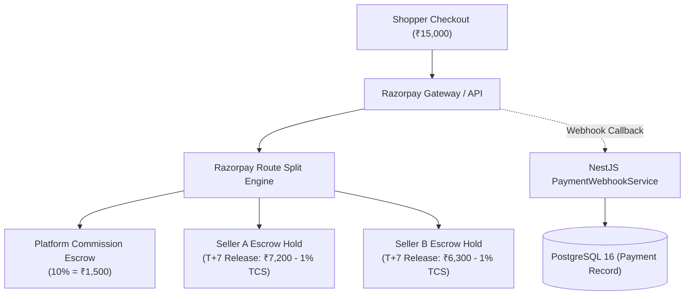
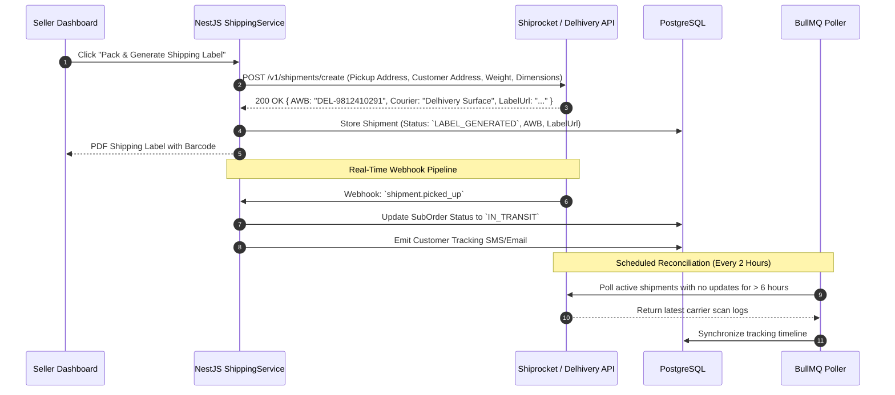
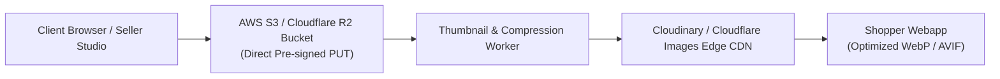
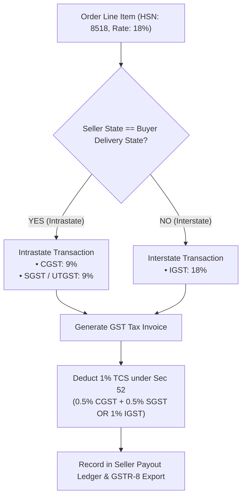
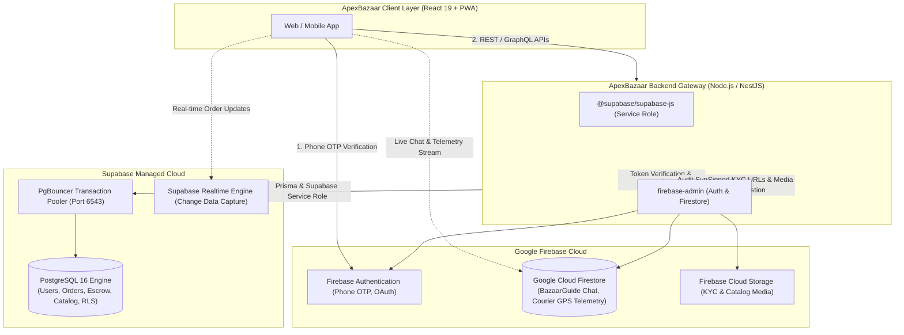

# 🔌 External Integrations, Webhooks & Tax Compliance — ApexBazaar

**Document Version:** 1.0.0  
**Status:** Under Review / Ratified  
**Author:** Principal Integrations Architect & Financial Systems Engineering  
**Scope:** Payment Gateways, 3PL Shipping, Communications, Media CDNs & Indian GST Engine  

---

## 1. Payment Gateway Architecture: Razorpay Route & Stripe Connect

ApexBazaar integrates **Razorpay** as its primary gateway for domestic Indian transactions (UPI, Cards, NetBanking, COD) and **Stripe Connect** as its secondary gateway for international card settlements.



### 1.1 Razorpay Route & Split Settlement Configuration
- **Linked Accounts:** Every verified seller has a dedicated Razorpay Linked Account (`acc_xxxx`) created during KYC approval.
- **Transfers API Call:** Executed automatically during order creation or payment capture:
  ```json
  {
    "amount": 1500000,
    "currency": "INR",
    "transfers": [
      {
        "account": "acc_seller_A_123",
        "amount": 712000,
        "currency": "INR",
        "on_hold": 1,
        "on_hold_until": 1794004800
      },
      {
        "account": "acc_seller_B_456",
        "amount": 623700,
        "currency": "INR",
        "on_hold": 1,
        "on_hold_until": 1794004800
      }
    ]
  }
  ```
- **Escrow Release Trigger:** When return window elapses without dispute, a BullMQ job calls `POST /v1/transfers/{transfer_id}/release`.

### 1.2 Webhook Signature Verification & Idempotency
All incoming webhooks are validated using HMAC-SHA256 signature verification before processing:

```typescript
// Sample Production Webhook Guard Snippet
import * as crypto from 'crypto';

export function verifyRazorpayWebhook(
  rawBody: string,
  receivedSignature: string,
  webhookSecret: string
): boolean {
  const expectedSignature = crypto
    .createHmac('sha256', webhookSecret)
    .update(rawBody)
    .digest('hex');

  return crypto.timingSafeEqual(
    Buffer.from(receivedSignature, 'utf8'),
    Buffer.from(expectedSignature, 'utf8')
  );
}
```

#### Webhook Event Processing Matrix
| Webhook Event Name | Source | Action Executed by ApexBazaar | Idempotency Key Strategy |
| :--- | :--- | :--- | :--- |
| `order.paid` | Razorpay | Confirms Master Order, generates Vendor Sub-Orders, decrements variant stock. | `rzp_event_id` stored in Redis with 24h TTL |
| `payment.failed` | Razorpay | Marks payment failed, records failure reason code, alerts shopper to retry. | `rzp_payment_id` |
| `transfer.processed`| Razorpay Route | Updates SubOrder `escrowStatus = RELEASED`, marks payout record disbursed. | `transfer_id` |
| `refund.processed` | Razorpay | Updates `Refund` record to `COMPLETED`, restores inventory if restockable. | `refund_id` |

---

## 2. Shipping & Logistics Integrations: Shiprocket & Delhivery

ApexBazaar integrates natively with **Shiprocket** and **Delhivery** APIs for multi-carrier logistics aggregation, rate optimization, automated AWB generation, and real-time package telemetry.



### 2.1 Carrier Circuit Breakers & Failure Handling
- **Circuit Breaker Policy:** Monitored via `Opossum`. If 5 consecutive calls to Shiprocket fail (timeout > 3,500ms):
  - Circuit opens for 45 seconds.
  - Shipping requests are queued as `PENDING_CARRIER_ALLOCATION`.
  - Background worker retries automatically with exponential backoff (`[10s, 30s, 90s, 300s]`).
  - Sellers are informed: *"Label generation queued. You will be notified in < 5 mins."*

---

## 3. Communication & Notification Gateways: SMS & Email

### 3.1 SMS & WhatsApp Messaging (Twilio & Gupshup)
- **Primary Channels:** Transactional SMS for Phone OTP, Order Confirmation, and Doorstep Delivery OTP.
- **Provider Redundancy:** **Gupshup** (Primary for India with pre-registered DLT templates) + **Twilio** (Automatic international fallback).
- **Indian DLT Compliance:** All SMS templates registered with TRAI DLT portals with verified Entity IDs and Template IDs:
  - *OTP Template:* `Your ApexBazaar verification code is {#var#}. Valid for 5 minutes. Do not share this code.` (Template ID: `140716...`)

### 3.2 Transactional Email (AWS SES)
- **Provider:** AWS Simple Email Service (SES) with dedicated IP pool.
- **Authentication:** Strict **SPF**, **DKIM** (2048-bit), and **DMARC** policy (`p=reject`).
- **Templates:** Responsive HTML templates compiled via React Email (`@react-email/components`) for:
  - Customer Order Receipt with itemized GST breakdown.
  - Seller New Order Alert with pack-by deadline.
  - Return Approval & Reverse Pickup AWB details.
- **Bounce & Complaint Handling:** SNS topic routes SES bounce notifications to NestJS webhook:
  - Hard bounce (`Permanent`): User's `isEmailVerified` flagged false; future marketing emails suppressed.

---

## 4. Media Storage, Image Optimization & CDN



### 4.1 Storage Architecture
1. **Public Media Bucket (`s3://media.apexbazaar.com`):**
   - Stores catalog product images, category icons, store banners.
   - Served globally via Cloudflare CDN with immutable cache headers (`Cache-Control: public, max-age=31536000, immutable`).
2. **Private Secure Bucket (`s3://secure-kyc.apexbazaar.com`):**
   - Stores seller KYC certificates (GSTIN proof, PAN cards, cancelled cheques).
   - Zero public access; accessible strictly via IAM role or temporary 15-minute pre-signed URLs generated for Admin review.
3. **On-The-Fly Responsive Image Transformation:**
   - URL schema: `https://cdn.apexbazaar.com/products/var_sony_1.jpg?w=800&q=80&format=webp`
   - Automatically converts bloated JPEGs/PNGs into next-gen WebP/AVIF formats based on client `Accept` headers, reducing PDP payload size by up to 70%.

---

## 5. Indian Taxation & GST Compliance Engine

ApexBazaar enforces automated, mathematically rigorous Indian Goods and Services Tax (GST) calculations for every line item:



### 5.1 Tax Mathematical Rules
1. **Intrastate Supply (e.g., Seller in Karnataka → Buyer in Karnataka):**
   $$\text{CGST} = \text{Taxable Base Value} \times 9\%$$
   $$\text{SGST} = \text{Taxable Base Value} \times 9\%$$
2. **Interstate Supply (e.g., Seller in Karnataka → Buyer in Maharashtra):**
   $$\text{IGST} = \text{Taxable Base Value} \times 18\%$$
3. **Marketplace TCS (Tax Collected at Source):**
   - Under Section 52 of the CGST Act 2017, the platform withholds **1.0%** of net taxable sales:
     - $0.5\% \text{ CGST} + 0.5\% \text{ SGST}$ for intrastate orders.
     - $1.0\% \text{ IGST}$ for interstate orders.
   - TCS is remitted by ApexBazaar directly to the Indian Government and credited to the seller's GST Cash Ledger.
4. **Automated Monthly GSTR-8 Export:**
   - BullMQ cron runs on the 1st of every calendar month, aggregating gross sales, returns, and net tax collected per seller GSTIN, formatting the report for direct upload to the GST portal.

---

## 6. Supabase & Firebase Hybrid Cloud Services Integration

ApexBazaar integrates Supabase and Firebase in a symbiotic architecture to balance relational ACID guarantees with high-throughput real-time events:



### 6.1 Supabase Configuration & Client Initialization
- **Connection Pooling:** In production, backend applications connect through Supabase PgBouncer on port `6543` with `?pgbouncer=true` to handle up to 10,000+ concurrent connections without exhausting PostgreSQL process limits.
- **Server-Side Initialization:**
  ```javascript
  import { createClient } from '@supabase/supabase-js';

  const supabaseUrl = process.env.SUPABASE_URL;
  const supabaseServiceKey = process.env.SUPABASE_SERVICE_ROLE_KEY;

  export const supabaseAdmin = createClient(supabaseUrl, supabaseServiceKey, {
    auth: {
      autoRefreshToken: false,
      persistSession: false
    }
  });
  ```
- **Row-Level Security (RLS) Interoperability:** When querying with user context, the backend can pass user tokens or execute via service role for administrative escrow actions.

### 6.2 Firebase Admin SDK & Services Configuration
- **Initialization Snippet:**
  ```javascript
  import admin from 'firebase-admin';

  if (!admin.apps.length) {
    admin.initializeApp({
      credential: admin.credential.cert({
        projectId: process.env.FIREBASE_PROJECT_ID,
        clientEmail: process.env.FIREBASE_CLIENT_EMAIL,
        privateKey: process.env.FIREBASE_PRIVATE_KEY?.replace(/\\n/g, '\n'),
      }),
      storageBucket: process.env.FIREBASE_STORAGE_BUCKET
    });
  }

  export const firebaseAuth = admin.auth();
  export const firestore = admin.firestore();
  export const firebaseStorage = admin.storage();
  ```

### 6.3 Resilience & Local Development Fallbacks
- To prevent local development bottlenecks when external cloud credentials are not provisioned:
  1. **Supabase Fallback:** The backend dynamically checks connectivity. If `SUPABASE_URL` is unavailable, it gracefully operates against local PostgreSQL via Prisma ORM or in-memory mock adapters.
  2. **Firebase Fallback:** If Firebase credentials are not provided or set to mock values, `firebaseAuth` and `firestore` invoke mock providers in test/offline environments, generating development tokens and simulating Firestore document reads/writes without raising unhandled rejection errors.

