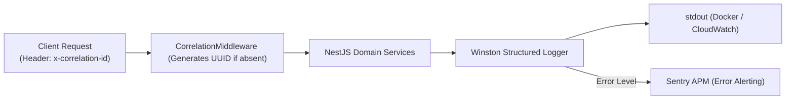
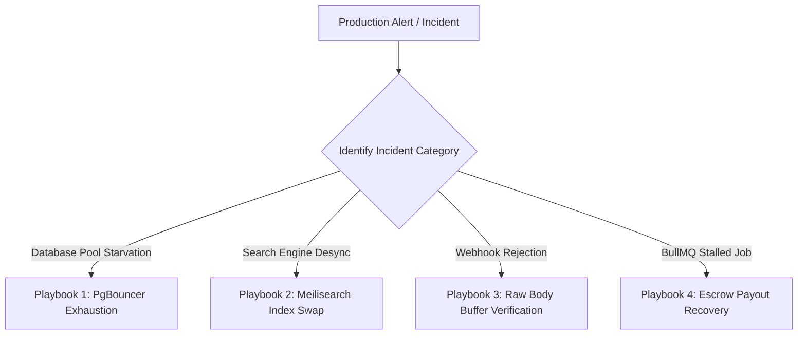

# 🔍 Logging, Observability & Troubleshooting Playbook — ApexBazaar

**Document Version:** 1.0.0  
**Status:** Under Review / Ratified  
**Author:** Principal SRE & Operations Engineering Team  
**Monitoring Stack:** Winston, Sentry APM, Prometheus, Grafana, OpenTelemetry  

---

## 1. Structured Logging Architecture

ApexBazaar enforces a centralized, structured JSON logging paradigm using **Winston**. Every HTTP request, queue worker execution, and database transaction attaches an immutable **Correlation ID** (`x-correlation-id`) that propagates across all domain boundaries.



### 1.1 Standard JSON Log Schema
```json
{
  "timestamp": "2026-11-01T14:32:10.842Z",
  "level": "error",
  "message": "Payment signature verification failed for Razorpay order 'order_rzp_Live123'",
  "correlationId": "req_8f1d2e9c-3a4b-4c5d-6e7f-8a9b0c1d2e3f",
  "context": "PaymentService",
  "service": "apexbazaar-api",
  "environment": "production",
  "userId": "usr_9b1deb4d-3b7d-4bad-9bdd-2b0d7b3dcb6d",
  "ipAddress": "203.0.113.195",
  "durationMs": 42,
  "stack": "Error: Signature mismatch\n    at PaymentService.verifySignature (/app/dist/modules/payments/payment.service.js:84:13)...",
  "metadata": {
    "orderId": "APX-202611-98124",
    "gatewayOrderId": "order_rzp_Live123"
  }
}
```

### 1.2 PII Redaction Policy
To comply with the Indian DPDP Act 2023 and PCI-DSS standards, the logging pipeline automatically masks sensitive customer and merchant attributes before serialization:
- **Phone Numbers:** Masked as `+91 ***** *3210`.
- **Passswords & Tokens:** Completely replaced with `[REDACTED]`.
- **Bank Account & Card Numbers:** Masked leaving only the last 4 digits visible (`**** **** **** 1234`).

---

## 2. Observability & APM (Sentry, Prometheus & Grafana)

### 2.1 Prometheus Metrics Exposed (`/metrics`)
The API exposes standard Prometheus format metrics scraped every 15 seconds by Prometheus servers:

| Metric Name | Type | Description | Alerting Threshold |
| :--- | :--- | :--- | :--- |
| `http_request_duration_seconds` | Histogram | Request latency partitioned by route and method | P95 > 250ms for 5 consecutive minutes |
| `http_requests_total` | Counter | Total throughput partitioned by status code | `5xx` rate > 1.0% of total traffic |
| `prisma_pool_connections_waiting` | Gauge | Queries waiting for a free database connection | Waiting > 10 queries triggers urgent warning |
| `bullmq_jobs_waiting_total` | Gauge | Backlog depth of BullMQ worker queues | `search-sync` > 500 or `notifications` > 1,000 |
| `meilisearch_query_duration_ms` | Histogram | Latency of catalog search queries | P95 > 50ms |

### 2.2 Sentry APM Configuration
- **Transaction Tracing:** Set to 10% sampling in production (`tracesSampleRate: 0.10`), 100% on error events.
- **Custom Tags:** Every captured exception attaches:
  - `role`: Role of the actor (`SELLER`, `CUSTOMER`, `ADMIN`).
  - `sellerProfileId`: Seller identifier for vendor dashboard errors.
  - `subOrderNumber`: Order identifier for fulfillment failures.

---

## 3. Common Production Errors & Troubleshooting Playbooks



---

### Playbook 1: `PRISMA_P2024_CONNECTION_POOL_TIMEOUT`
- **Symptom:** API logs show `PrismaClientKnownRequestError: Timed out fetching a new connection from the connection pool`.
- **Root Cause:** Spike in slow analytical queries or unindexed relations causing worker threads to hold PostgreSQL connections longer than the 5,000ms timeout.
- **Immediate Mitigation:**
  1. Inspect active PostgreSQL queries:
     ```sql
     SELECT pid, now() - pg_stat_activity.query_start AS duration, query, state 
     FROM pg_stat_activity 
     WHERE state != 'idle' ORDER BY duration DESC;
     ```
  2. Terminate rogue slow queries holding locks:
     ```sql
     SELECT pg_terminate_backend(pid);
     ```
  3. Increase PgBouncer default pool size in `docker-compose` or cloud config:
     ```bash
     DEFAULT_POOL_SIZE=50
     ```

---

### Playbook 2: `MEILISEARCH_INDEX_OUT_OF_SYNC_OR_LOCKED`
- **Symptom:** Customers report newly listed products are not appearing in search results, or out-of-stock items still appear in facets.
- **Root Cause:** BullMQ `search-sync` worker crashed or failed to flush index tasks due to a disk space or Meilisearch process restart.
- **Zero-Downtime Re-Indexing Runbook:**
  ApexBazaar implements zero-downtime index aliasing. Execute the automated re-indexing utility:
  ```bash
  npm run meili:reindex -- --alias=products
  ```
  *Workflow executed by script:*
  1. Creates temporary index `products_tmp_<timestamp>`.
  2. Streams all published products and dynamic attributes from PostgreSQL in batches of 1,000.
  3. Applies synonyms, stop-words, and ranking rules to the temporary index.
  4. Swaps the `products` alias from the old index to `products_tmp_<timestamp>`.
  5. Drops the legacy index safely.

---

### Playbook 3: `RAZORPAY_WEBHOOK_SIGNATURE_MISMATCH`
- **Symptom:** Razorpay payment webhooks return HTTP 400 with message `Invalid webhook signature`. Customer orders remain in `PENDING_PAYMENT` despite successful bank debit.
- **Root Cause:** An upstream Express middleware (such as `bodyParser.json()`) parsed and mutated the raw request body before the HMAC-SHA256 signature verifier could inspect the raw bytes.
- **Resolution:**
  Ensure the raw buffer is preserved specifically for the webhook endpoint in `main.ts`:
  ```typescript
  app.use('/api/v1/payments/webhook', express.raw({ type: 'application/json' }));
  ```
  Verify that the `RAZORPAY_WEBHOOK_SECRET` in environment variables matches the secret configured in the Razorpay Merchant Dashboard.

---

### Playbook 4: `BULLMQ_STALLED_ESCROW_PAYOUT_JOB`
- **Symptom:** A seller payout job in `escrow-settlement` queue is marked `stalled` after a worker node crashed during API communication with the payment gateway.
- **Root Cause:** Node process was terminated before job completion acknowledgment, leaving the transfer state ambiguous.
- **Resolution Runbook:**
  1. Check the Razorpay Route dashboard for transfer ID corresponding to `subOrderId`.
  2. If the transfer was executed by Razorpay:
     - Mark the DB record `payout.isDisbursed = true` manually or via admin CLI:
       ```bash
       npm run cli:payout -- --reconcile-suborder=APX-202611-98124-S1
       ```
  3. If the transfer was **not** executed by Razorpay:
     - Clear the stalled job lock from Redis:
       ```bash
       npm run bullmq:retry -- --queue=escrow-settlement --job-id=<job_id>
       ```

---

## 4. Production Incident Management & Severity Matrix

| Severity Level | Definition | Response SLA | Escalation Target |
| :--- | :--- | :---: | :--- |
| **SEV-1 (Critical)** | Entire platform down, payment gateway failing for all users, or data corruption. | < 15 Minutes | Head of Engineering + Lead Architect + On-Call DevOps |
| **SEV-2 (Major)** | Core feature degraded (e.g., search broken, shipping label generation failing for all sellers). | < 45 Minutes | Senior Backend Lead + 3PL Integrations Lead |
| **SEV-3 (Minor)** | Non-critical component degraded (e.g., promotional banner rendering incorrectly, reviews delayed). | < 4 Hours | Assigned Sprint Engineer |
| **SEV-4 (Low)** | Minor UI styling glitch or typographical error in documentation. | Next Business Day | Standard Product Backlog |

