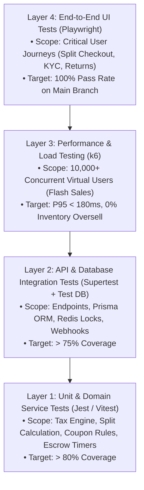

# 🧪 Quality Assurance, Automated Testing & Load Testing Strategy — ApexBazaar

**Document Version:** 1.0.0  
**Status:** Under Review / Ratified  
**Author:** Principal QA Architect & Performance Engineering Squad  
**Frameworks:** Jest, Vitest, Supertest, Playwright, k6  

---

## 1. Testing Pyramid & Quality Thresholds

ApexBazaar enforces a rigorous, multi-layered automated testing pyramid across both frontend and backend modules:



### Coverage Targets by Architectural Domain
| Domain | Minimum Unit Coverage | Minimum Integration Coverage | Critical E2E Scenarios |
| :--- | :---: | :---: | :--- |
| **Split Order & Checkout Engine** | 90% | 85% | Multi-vendor cart split payment, stock locking |
| **Tax & Indian GST Engine** | 95% | 90% | Intrastate (CGST+SGST) vs Interstate (IGST), 1% TCS |
| **Authentication & RBAC** | 85% | 85% | OTP rate-limiting, JWT rotation, role guards |
| **Seller Escrow & Payouts** | 90% | 85% | T+7 release cron, refund escrow debit, ledger math |
| **Search & Facets Engine** | 80% | 75% | Typo tolerance, dynamic JSONB filtering |

---

## 2. Sample Unit Test: Multi-Seller Split & Tax Engine

Validates the mathematical calculation of seller net payouts, GST splits, and platform take-rates:

```typescript
// tests/unit/split-order-calculator.spec.ts
import { describe, it, expect } from 'vitest';
import { calculateOrderSplit } from '../../src/modules/orders/utils/split-calculator';

describe('SplitOrderCalculator Engine', () => {
  it('correctly calculates split order amounts, interstate IGST, and platform commission', () => {
    const mockCart = {
      buyerState: 'Maharashtra',
      sellerA: {
        sellerId: 'sel_tech_direct',
        sellerState: 'Karnataka', // Interstate -> IGST 18%
        items: [{ price: 20000, quantity: 1, taxRatePercent: 18 }],
        commissionPercent: 10.0,
      },
      sellerB: {
        sellerId: 'sel_mumbai_fashion',
        sellerState: 'Maharashtra', // Intrastate -> CGST 9% + SGST 9%
        items: [{ price: 5000, quantity: 1, taxRatePercent: 18 }],
        commissionPercent: 15.0,
      },
    };

    const result = calculateOrderSplit(mockCart);

    // 1. Verify Seller A (Interstate)
    expect(result.subOrders[0].taxType).toBe('IGST');
    expect(result.subOrders[0].taxAmount).toBe(3050.85); // 20000 * 18/118
    expect(result.subOrders[0].commissionAmount).toBe(2000.00); // 10% of 20000
    expect(result.subOrders[0].sellerNetPayout).toBe(17800.00); // 20000 - 2000 - 1% TCS (200)

    // 2. Verify Seller B (Intrastate)
    expect(result.subOrders[1].taxType).toBe('CGST_SGST');
    expect(result.subOrders[1].cgstAmount).toBe(381.36); // 9%
    expect(result.subOrders[1].sgstAmount).toBe(381.36); // 9%
    expect(result.subOrders[1].commissionAmount).toBe(750.00); // 15% of 5000
    expect(result.subOrders[1].sellerNetPayout).toBe(4200.00); // 5000 - 750 - 1% TCS (50)

    // 3. Verify Master Order Grand Total
    expect(result.masterOrder.grandTotal).toBe(25000.00);
  });
});
```

---

## 3. Sample Integration Test: Phone OTP & Checkout API

Tests the authenticated lifecycle from OTP verification to authorized checkout order creation using Supertest and a dedicated test database:

```typescript
// tests/integration/auth-checkout.spec.ts
import request from 'supertest';
import { INestApplication } from '@nestjs/common';
import { initTestApp } from '../helpers/test-bootstrap';

describe('POST /api/v1/orders/confirm (Integration)', () => {
  let app: INestApplication;
  let accessToken: string;

  beforeAll(async () => {
    app = await initTestApp();
  });

  it('authenticates user via Phone OTP and executes idempotent order confirmation', async () => {
    // 1. Verify OTP and obtain Access Token
    const authRes = await request(app.getHttpServer())
      .post('/api/v1/auth/phone/otp-verify')
      .send({ phoneNumber: '+919876543210', otp: '123456' })
      .expect(200);

    accessToken = authRes.body.data.accessToken;
    expect(accessToken).toBeDefined();

    // 2. Execute Idempotent Order Confirmation
    const orderPayload = {
      gatewayOrderId: 'order_test_rzp_98124',
      gatewayPaymentId: 'pay_test_87123',
      gatewaySignature: 'test_valid_hmac_signature',
    };

    const checkoutRes = await request(app.getHttpServer())
      .post('/api/v1/orders/confirm')
      .set('Authorization', `Bearer ${accessToken}`)
      .set('Idempotency-Key', 'idem_uuid_89a1b2c3')
      .send(orderPayload)
      .expect(201);

    expect(checkoutRes.body.success).toBe(true);
    expect(checkoutRes.body.data.masterOrderNumber).toMatch(/^APX-/);
    expect(checkoutRes.body.data.subOrders.length).toBeGreaterThanOrEqual(1);

    // 3. Repeat request with same Idempotency-Key (Must return cached result, zero duplicate rows)
    const duplicateRes = await request(app.getHttpServer())
      .post('/api/v1/orders/confirm')
      .set('Authorization', `Bearer ${accessToken}`)
      .set('Idempotency-Key', 'idem_uuid_89a1b2c3')
      .send(orderPayload)
      .expect(201);

    expect(duplicateRes.body.data.masterOrderNumber).toBe(checkoutRes.body.data.masterOrderNumber);
  });
});
```

---

## 4. End-to-End (E2E) Test Scenario: Playwright

Automates the complete multi-vendor discovery, cart aggregation, and checkout workflow:

```typescript
// tests/e2e/multi-vendor-checkout.spec.ts
import { test, expect } from '@playwright/test';

test.describe('Multi-Vendor Cart & Split Checkout Journey', () => {
  test('user searches for electronics, adds items from 2 sellers, and completes split order', async ({ page }) => {
    // 1. Visit Homepage & Search for Headphones
    await page.goto('http://localhost:5173');
    await page.fill('input[placeholder*="Search"]', 'Sony headphones');
    await page.keyboard.press('Enter');

    // 2. Click Product Card and Add to Cart (Seller A)
    await page.locator('text=Sony WH-1000XM5').first().click();
    await page.locator('button:has-text("Add to Cart")').click();
    await expect(page.locator('text=Added to Cart')).toBeVisible();

    // 3. Navigate to Fashion Category and Add Jacket (Seller B)
    await page.goto('http://localhost:5173/categories/fashion');
    await page.locator('text=Classic Denim Jacket').first().click();
    await page.locator('button:has-text("Add to Cart")').click();

    // 4. Open Slide-Over Cart Drawer & Verify 2 Distinct Vendor Groups
    await page.locator('button[aria-label="Open Cart"]').click();
    await expect(page.locator('text=CloudAudio Direct')).toBeVisible();
    await expect(page.locator('text=UrbanStyles Fashion')).toBeVisible();

    // 5. Click Proceed to Checkout
    await page.locator('button:has-text("Proceed to Split Checkout")').click();
    await page.waitForURL('**/checkout');

    // 6. Select Delivery Address & Verify Split Summary
    await page.locator('input[type="radio"][name="address"]').first().check();
    await page.locator('button:has-text("Continue to Payment")').click();

    // 7. Verify Razorpay Modal Trigger
    await expect(page.locator('text=Select Payment Method')).toBeVisible();
  });
});
```

---

## 5. High-Concurrency Load Testing: k6 Script (10,000 Concurrent VUs)

Simulates a high-traffic flash sale verifying sub-30ms search latency and atomic stock locking with zero negative inventory:

```javascript
// tests/load/flash-sale-load-test.js
import http from 'k6/http';
import { check, sleep } from 'k6';

export const options = {
  stages: [
    { duration: '1m', target: 2000 },  // Ramp-up to 2,000 VUs
    { duration: '3m', target: 10000 }, // Peak at 10,000 concurrent VUs
    { duration: '2m', target: 10000 }, // Maintain peak concurrency
    { duration: '1m', target: 0 },     // Ramp-down
  ],
  thresholds: {
    'http_req_duration{type:search}': ['p(95)<30'],   // 95% of searches < 30ms
    'http_req_duration{type:checkout}': ['p(95)<250'], // 95% of checkouts < 250ms
    'http_req_failed': ['rate<0.01'],                 // Error rate < 1%
  },
};

const BASE_URL = 'http://localhost:4000/api/v1';

export default function () {
  // 1. Simulate Typo-Tolerant Search Query
  const searchRes = http.get(`${BASE_URL}/search?q=wireless+earbuds&minPrice=1000&maxPrice=5000`, {
    tags: { type: 'search' },
  });

  check(searchRes, {
    'search status is 200': (r) => r.status === 200,
    'search latency < 30ms': (r) => r.timings.duration < 30,
  });

  sleep(Math.random() * 2 + 1); // User reading results

  // 2. Simulate Flash Sale Checkout Locking Attempt
  const checkoutPayload = JSON.stringify({
    productVariantId: 'var_flash_sale_sku_01',
    quantity: 1,
    shippingAddressId: 'addr_test_1234',
  });

  const checkoutRes = http.post(`${BASE_URL}/orders/checkout-intent`, checkoutPayload, {
    headers: { 'Content-Type': 'application/json', Authorization: 'Bearer test_token' },
    tags: { type: 'checkout' },
  });

  check(checkoutRes, {
    'checkout responds with 200 (Success) or 422 (Sold Out)': (r) =>
      r.status === 200 || r.status === 422,
  });

  sleep(1);
}
```

